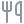

# Chinese Immersion Library

A curated list of **Chinese-language content for learners**: YouTube and Bilibili channels, podcasts, news, dramas, variety shows, manhua, web novels, music, kids' shows, dictionaries, apps and exam prep, from beginner to native level.

- **Browse with search and filters:** [krmanik.github.io/chinese-immersion-library](https://krmanik.github.io/chinese-immersion-library/)
- **Use it in an app:** every entry is also served as static JSON. See the [JSON API docs](docs/API.md).
- **Add a resource:** see [CONTRIBUTING.md](CONTRIBUTING.md), or [open a suggestion](https://github.com/krmanik/chinese-immersion-library/issues/new?template=add-resource.yml) without touching any code.

This list powers the Feed tab of [Hanzi Popup](https://github.com/krmanik/Hanzi-Popup-iOS).

> The list below is generated from [`data/`](data/) by `scripts/build.py`. To change an entry, edit the JSON in `data/`, not this file.

<!-- BEGIN GENERATED LIST: edit data/*.json and run scripts/build.py -->

## Contents

- **[Learn](#learn)**
  -  [Learn Chinese: Video](#learn-chinese-video) · 59
  -  [Learn Chinese: Podcasts](#learn-chinese-podcasts) · 43
  -  [Graded Reading](#graded-reading) · 21
  -  [Courses & Grammar](#courses--grammar) · 24
  -  [Dictionaries & Tools](#dictionaries--tools) · 22
  -  [Learning Apps](#learning-apps) · 17
  -  [HSK & TOCFL](#hsk--tocfl) · 10
  -  [Tutors & Community](#tutors--community) · 9
  -  [About China (English)](#about-china-english) · 14
- **[Read](#read)**
  -  [News](#news) · 79
  -  [Tech](#tech) · 29
  -  [Business & Finance](#business--finance) · 18
  -  [Science & Knowledge](#science--knowledge) · 23
  -  [History & Culture](#history--culture) · 16
  -  [Web Novels](#web-novels) · 15
  -  [Literature & Classics](#literature--classics) · 12
  -  [Books & E-books](#books--e-books) · 9
  -  [Comics & Manhua](#comics--manhua) · 11
  -  [Social & Forums](#social--forums) · 8
- **[Watch](#watch)**
  -  [Streaming Platforms](#streaming-platforms) · 21
  -  [Drama & Film](#drama--film) · 24
  -  [Variety & Talk Shows](#variety--talk-shows) · 11
  -  [Comedy & Crosstalk](#comedy--crosstalk) · 16
  -  [Documentaries](#documentaries) · 10
  -  [Vlogs & Lifestyle](#vlogs--lifestyle) · 20
  -  [Food & Cooking](#food--cooking) · 25
  -  [Travel](#travel) · 17
  -  [Animation (Donghua)](#animation-donghua) · 13
  -  [Kids & Family](#kids--family) · 22
  -  [Gaming](#gaming) · 16
  -  [Sports & Fitness](#sports--fitness) · 12
- **[Listen](#listen)**
  -  [Music](#music) · 31
  -  [Chinese Podcasts](#chinese-podcasts) · 36
  -  [Radio & Audiobooks](#radio--audiobooks) · 10

**723 resources.** After each entry: *For learners* when it is made for learners, then level · 简 simplified / 繁 traditional · region · language if not all Chinese · pricing if not free.

## Learn

### Learn Chinese: Video

学中文视频 · YouTube channels made for learners: comprehensible input, lessons, grammar.

 **YouTube**

- [Acquire Mandarin](https://www.youtube.com/@acquiremandarin) - Chinese-only content using pictures and body language for beginner to intermediate learners. *For learners* · Beginner–Intermediate · 简 · CN
- [Alison Mandarin](https://www.youtube.com/@alisonmandarin1729) - Natural conversations and stories, each in normal-speed and slower versions. *For learners* · Beginner–Intermediate · 简 · CN
- [BlaBla Chinese](https://www.youtube.com/@blablachinese7526) - Well-produced, slow-paced story videos for super-beginners to intermediate learners. *For learners* · Beginner–Intermediate · 简 · CN
- [Canto to Mando](https://www.youtube.com/@cantotomando) - A Cantonese speaker's journey learning Mandarin, with comparisons and tips. *For learners* · Beginner–Intermediate · 简 · CN · Bilingual
- [Chinese Daily Podcast](https://www.youtube.com/@ChineseDailyPodcast) - Daily conversational listening practice with subtitles. *For learners* · Beginner–Intermediate · 简 · CN
- [Chinese Mandarin Cherry](https://www.youtube.com/@chinesemandarincherry) - A2-level listening-practice videos; many work well as audio-only. *For learners* · Beginner–Intermediate · 简 · CN
- [Chinese Podcast With Shenglan](https://www.youtube.com/@ChinesePodcastWithShenglan) - Video podcasts and vlogs on travel, daily life, news and history that bridge to native content. *For learners* · Intermediate · 简 · CN
- [Chinese with Jessie](https://www.youtube.com/@ChinesewithJessie) - Hugely popular beginner lessons on phrases, grammar and conversation. *For learners* · Beginner · 简 · CN · English
- [Chinese with LTL](https://www.youtube.com/@LTLChinese) - LTL Mandarin School lessons, slang and culture videos. *For learners* · Beginner–Intermediate · 简 · CN · English
- [Chinese with Mandarin HQ](https://www.youtube.com/@MandarinHQ) - Real-world Mandarin, accent comparisons and HSK vocabulary videos. *For learners* · Beginner–Intermediate · 简 · CN · Bilingual
- [Chinese Zero to Hero](https://www.youtube.com/@ChineseZeroToHero) - Well-organised HSK-aligned grammar and vocabulary lessons, including new HSK 7-9. *For learners* · All levels · 简 · CN · English
- [ChineseClass101](https://www.youtube.com/@ChineseClass101) - Bite-sized English-taught lessons for absolute beginners upward. *For learners* · Beginner · 简 · CN · English · Freemium
- [ChineseFor.Us](https://www.youtube.com/@ChineseForUsOfficial) - In-depth grammar videos and HSK courses taught in English. *For learners* · Beginner–Intermediate · 简 · CN · English
- [ChinesePod](https://www.youtube.com/@ChinesePodTV) - Long-running dialogue-based lessons organised by level. *For learners* · All levels · 简 · CN · Bilingual · Freemium
- [Chloe Chinese Class](https://www.youtube.com/@chloechinesecoach) - Learner podcasts, conversations, story lessons and vlogs about life in China. *For learners* · Beginner–Intermediate · 简 · CN
- [Crazie Laoshi](https://www.youtube.com/@CrazieLaoshi) - Story-based teaching with many beginner-friendly playlists. *For learners* · Beginner · 简 · CN
- [Dashu Mandarin 大叔中文](https://www.youtube.com/@dashumandarin) - Unscripted conversations between teachers and guests on China and culture. *For learners* · Intermediate–Advanced · 简 · CN
- [Diane Neubauer 杜雁子](https://www.youtube.com/@DianeNeubauer) - Comprehension-based teacher channel with beginner Mandarin and reading playlists. *For learners* · Beginner · 简 · CN
- [Du Chinese](https://www.youtube.com/@DuChinese) - Video versions of Du Chinese graded lessons. *For learners* · Beginner–Intermediate · 简 · CN
- [Everyday Chinese](https://www.youtube.com/@EverydayChinese) - Situational dialogues for daily life: shopping, doctor, travel and more. *For learners* · Beginner–Intermediate · 简 · CN · Bilingual
- [Grace Mandarin Chinese](https://www.youtube.com/@GraceMandarinChinese) - Popular English-language videos on grammar, vocabulary, pronunciation and culture. *For learners* · Beginner–Intermediate · 简 · CN · English
- [Hacking Chinese](https://www.youtube.com/@HackingChinese) - Learning strategies for Mandarin by Olle Linge. *For learners* · All levels · 简 · CN · English
- [Harbin Mandarin](https://www.youtube.com/@HarbinMandarin) - Popular Chinese lessons and culture videos from Harbin. *For learners* · Beginner–Intermediate · 简 · CN · Bilingual
- [Hit Chinese](https://www.youtube.com/@HitChinese) - Beginner lessons using writing, drawing and body language. *For learners* · Beginner · 简 · CN
- [Kevin in Shanghai](https://www.youtube.com/@KevininShanghai) - Skits, street interviews and commentary on everyday life in China. *For learners* · Intermediate–Advanced · 简 · CN · Bilingual
- [Lazy Chinese](https://www.youtube.com/@Lazy-Chinese) - Chinese-only comprehensible-input stories, culture and casual talk with visual support. *For learners* · Beginner–Intermediate · 简 · CN
- [Learn Chinese Online](https://www.youtube.com/@LearnChineseOnline) - Structured beginner course videos. *For learners* · Beginner · 简 · CN · English
- [Learn Chinese Through Podcast](https://www.youtube.com/@LearnChineseThroughPodcast) - Podcast-style Mandarin listening practice with subtitles. *For learners* · Beginner–Intermediate · 简 · CN
- [Learn Chinese with Litao](https://www.youtube.com/@LitaoChinese) - Pronunciation-focused lessons on pinyin, tones and common mistakes. *For learners* · Beginner · 简 · CN · English
- [Learn Chinese with Yi Zhao](https://www.youtube.com/@YiZhaoHomemadeChinese) - Homemade Chinese lessons on grammar, culture and listening. *For learners* · Beginner–Intermediate · 简 · CN · Bilingual
- [Little Fox Chinese](https://www.youtube.com/@LittleFoxChinese) - Animated stories and songs for young learners of Chinese. *For learners* · Beginner · 简 · CN
- [Mandarin Blueprint](https://www.youtube.com/@MandarinBlueprint) - Character-learning method, pronunciation and learner mindset videos. *For learners* · Beginner–Intermediate · 简 · CN · English
- [Mandarin Click](https://www.youtube.com/@MandarinClick) - Slow, clear Chinese-only graded stories with strong visual and body-language support, organised by HSK level. *For learners* · Beginner–Intermediate · 简 · CN
- [Mandarin Companion](https://www.youtube.com/@MandarinCompanion) - Graded reader publisher: reading tips and story trailers. *For learners* · Beginner–Intermediate · 简 · CN · English
- [Mandarin Corner](https://www.youtube.com/@MandarinCorner2) - Street interviews and long conversations with detailed Chinese/pinyin/English subtitles. *For learners* · All levels · 简 · CN
- [Mandarin Corner (Main)](https://www.youtube.com/@MandarinCorner) - Mandarin Corner's main channel with beginner series and vocabulary videos. *For learners* · All levels · 简 · CN · Bilingual
- [Mandarin Monkey](https://www.youtube.com/@MandarinMonkey) - Bilingual podcast-style conversations between a learner and native speaker. *For learners* · Intermediate · 繁 · TW · Bilingual
- [Mandarin Village 中文村](https://www.youtube.com/@MandarinVillage) - Chinese stories and bedtime tales for learners. *For learners* · Beginner–Intermediate · 简 · CN
- [MandarinBean](https://www.youtube.com/@MandarinBean) - Graded HSK readings and stories with audio. *For learners* · Beginner–Intermediate · 简 · CN
- [MaoMi Chinese](https://www.youtube.com/@maomichinese3683) - Video versions of the MaoMi Chinese podcast: read-aloud monologues on current topics. *For learners* · Intermediate · 简 · CN
- [Outlier Linguistics](https://www.youtube.com/@OutlierLinguistics) - How Chinese characters really work, plus learning advice. *For learners* · All levels · 简 · CN · English
- [PeggyTeachesChinese](https://www.youtube.com/@PeggyTeachesChinese) - Street interviews, Taiwan travel, everyday talk and HSK prep. *For learners* · Beginner–Intermediate · 繁 · TW · Bilingual
- [Say Ninhao](https://www.youtube.com/@sayninhao-chinese) - HSK-structured lessons and listening practice. *For learners* · Beginner–Intermediate · 简 · CN · Bilingual
- [ShuoshuoChinese 说说中文](https://www.youtube.com/@ShuoshuoChinese) - English-language videos on phrases, grammar and pronunciation. *For learners* · Beginner–Intermediate · 简 · CN · English
- [Skritter](https://www.youtube.com/@SkritterHQ) - Videos on characters, culture and history with English scaffolding. *For learners* · Beginner–Intermediate · 简 · CN · English
- [Slow & Clear Chinese](https://www.youtube.com/@immersivechinese) - Beginner listening practice with no English, using gestures, props and images. *For learners* · Beginner · 简 · CN
- [Speak Chinese with Da Peng 大鹏说中文](https://www.youtube.com/@chinese9339) - Clear-speaking host with daily expressions, learner interviews and monologues. *For learners* · Intermediate–Advanced · 简 · CN
- [Stickynote Chinese](https://www.youtube.com/@Stickynote.Chinese) - Small set of comprehensible-input videos for absolute beginners. *For learners* · Beginner · 简 · CN
- [Story Learning Chinese with Annie](https://www.youtube.com/@annieluo1307) - Longer relaxed stories, picture talks, listening games and shadowing, mostly in Chinese. *For learners* · Beginner–Intermediate · 简 · CN
- [SyS Mandarin](https://www.youtube.com/@sysmandarin) - Learn Chinese through authentic materials: dramas, songs and native content. *For learners* · Intermediate–Advanced · 简 · CN · Bilingual
- [Taiwanese Mandarin With Miss Lin](https://www.youtube.com/@MandarinWithMissLin) - Taiwanese Mandarin lessons and TOCFL-oriented practice. *For learners* · Beginner–Intermediate · 繁 · TW · Bilingual
- [TeaTime Chinese 茶歇中文](https://www.youtube.com/@TeaTimeChinese) - Slow, clear Chinese monologues on varied topics, almost entirely in Chinese. *For learners* · Intermediate · 简 · CN
- [That's Mandarin](https://www.youtube.com/@ThatsMandarin) - Mandarin school channel with lessons on vocabulary, grammar and culture. *For learners* · Beginner–Intermediate · 简 · CN · English
- [Tingting Comprehensible Chinese](https://www.youtube.com/@ComprehensibleChinese) - Comprehensible-input Mandarin videos for beginners. *For learners* · Beginner · 简 · CN
- [Unconventional Chinese](https://www.youtube.com/@unconventionalchinese) - Language and travel content; the intermediate playlist is entertaining and travel-focused. *For learners* · Intermediate · 简 · CN · Bilingual
- [Will Hart 何威](https://www.youtube.com/@willhartmandarin) - A British advanced learner speaking Chinese on pronunciation and characters, plus learning tips. *For learners* · Intermediate–Advanced · 简 · CN · Bilingual
- [Xiaogua Chinese](https://www.youtube.com/@xiaoguachinese) - Large level-labelled library of stories, podcasts, travel videos and everyday topics. *For learners* · Beginner–Intermediate · 简 · CN
- [Yoyo Chinese](https://www.youtube.com/@YoyoChinese) - Large library of English-taught lessons on grammar, pronunciation and characters. *For learners* · Beginner–Intermediate · 简 · CN · English
- [李永乐老师 Li Yongle](https://www.youtube.com/channel/UCSs4A6HYKmHA2MG_0z-F0xw) - Free science and maths lessons in fast, clear Mandarin with whiteboard explanations. Advanced · 简 · CN

[Back to contents](#contents)

### Learn Chinese: Podcasts

学中文播客 · Podcasts made for learners, from slow Chinese to natural conversation.

 **Podcasts**

- [Chillchat (Learn Chinese and Chill)](https://podcasts.apple.com/podcast/id1475774488) - Shenzhen hosts teach words and phrases in context, with transcripts. *For learners* · Intermediate · 简 · CN · Bilingual
- [Chinese Explained](https://podcasts.apple.com/podcast/id1500549535) - Bite-sized episodes on culture and everyday expressions. *For learners* · Intermediate · 简 · CN · Bilingual
- [Chinese Podcast With Shenglan](https://podcasts.apple.com/podcast/id1630748801) - All-Chinese podcast on travel, life and culture for intermediate learners. *For learners* · Intermediate · 简 · CN
- [ChineseClass101 Podcast](https://podcasts.apple.com/podcast/id317130752) - English-taught beginner lessons. *For learners* · Beginner · 简 · CN · English · Freemium
- [ChinesePod - Advanced](https://podcasts.apple.com/podcast/id1529838325) - All-Chinese advanced lessons and studio discussion. *For learners* · Advanced · 简 · CN · Freemium
- [ChinesePod - Beginner](https://podcasts.apple.com/podcast/id1489328856) - Dialogue lessons for beginners with explanations. *For learners* · Beginner · 简 · CN · Bilingual · Freemium
- [ChinesePod - Intermediate](https://podcasts.apple.com/podcast/id1529834171) - Dialogue lessons for intermediate learners. *For learners* · Intermediate · 简 · CN · Bilingual · Freemium
- [Coffee Break Chinese](https://podcasts.apple.com/podcast/id1201255510) - Short structured lessons with a teacher and a learner (archive). *For learners* · Beginner · 简 · CN · English
- [Dashu Mandarin Podcast](https://podcasts.apple.com/podcast/id1614411825) - Unscripted group conversations among teachers and guests. *For learners* · Intermediate–Advanced · 简 · CN
- [Easy Mandarin News](https://podcasts.apple.com/podcast/id1819425599) - Daily news retold in easy Mandarin for learners. *For learners* · Intermediate · 简 · CN
- [Full Mandarin Stories by Mandarin Monkey](https://podcasts.apple.com/podcast/id1801754281) - Full-Mandarin storytelling episodes. *For learners* · Intermediate · 繁 · TW
- [Hacking Chinese Podcast](https://podcasts.apple.com/podcast/id1536284827) - In-depth discussions on how to learn Mandarin by Olle Linge. *For learners* · All levels · 简 · CN · English
- [I'm Learning Mandarin](https://podcasts.apple.com/podcast/id1581738411) - Discussions and interviews on specific topics in learning Chinese. *For learners* · All levels · 简 · CN · English
- [Lazy Chinese Podcast](https://podcasts.apple.com/podcast/id1610476816) - Slow, easy Chinese stories using comprehensible input and TPRS. *For learners* · Beginner–Intermediate · 简 · CN
- [Learn Chinese with Ju](https://podcasts.apple.com/podcast/id1542797718) - Guess-from-context immersive lessons at a slow pace. *For learners* · Intermediate · 简 · CN · Bilingual
- [Learn Chinese with Kaela](https://podcasts.apple.com/podcast/id1437065346) - English-free Chinese talks on psychology, society and feminism. *For learners* · Advanced · 简 · CN
- [Learn Mandarin in Mandarin with Huimin](https://podcasts.apple.com/podcast/id1573869563) - Long unscripted Taiwanese Mandarin monologues with CEFR difficulty ratings. *For learners* · Intermediate · 繁 · TW
- [Learn real-life Taiwanese Mandarin 聽播客學中文](https://podcasts.apple.com/podcast/id1567731121) - Real-life Taiwanese Mandarin conversations for learners. *For learners* · Intermediate · 繁 · TW
- [Learn Taiwanese Mandarin](https://podcasts.apple.com/podcast/id1502494666) - Casual, unscripted Taiwanese Mandarin monologues on current events and culture. *For learners* · Intermediate–Advanced · 繁 · TW
- [Learning Chinese through Stories](https://podcasts.apple.com/podcast/id942258146) - Story and explanation episode pairs taught almost entirely in Mandarin, graded by level. *For learners* · All levels · 简 · CN · Freemium
- [maayot: Learn Chinese with Beginner Stories](https://podcasts.apple.com/podcast/id1527047549) - Short stories under three minutes for every HSK level. *For learners* · Beginner–Intermediate · 简 · CN
- [Mandarin Blueprint Podcast](https://podcasts.apple.com/podcast/id1450153938) - Character, pronunciation and learning-method discussions. *For learners* · Beginner–Intermediate · 简 · CN · English
- [Mandarin Monkey Podcast](https://podcasts.apple.com/podcast/id1430708691) - Bilingual conversations about life in Taiwan, culture and learning. *For learners* · Intermediate · 繁 · TW · Bilingual
- [Mandarin To Go: Daily Chinese Dialogues](https://podcasts.apple.com/podcast/id1886740987) - Short daily dialogues for practical Mandarin. *For learners* · Beginner · 简 · CN · Bilingual
- [MaoMi Chinese](https://podcasts.apple.com/podcast/id1548129463) - Scripted Chinese monologues on current topics with Chinese explanations and transcripts. *For learners* · Intermediate · 简 · CN · Freemium
- [Melnyks Chinese](https://podcasts.apple.com/podcast/id119843495) - Theme-based audio lessons with heavy repetition. *For learners* · Beginner · 简 · CN · English · Freemium
- [Mini Mandarin](https://podcasts.apple.com/podcast/id1346216138) - Short, sweet Chinese phrases step by step. *For learners* · Beginner · 简 · CN · Bilingual
- [One Chinese Word a Day](https://podcasts.apple.com/podcast/id1496558377) - Two-minute episodes building words and phrases around one character. *For learners* · Beginner–Intermediate · 简 · CN · Bilingual
- [Slow Chinese Podcast (Learn Chinese with Mei)](https://podcasts.apple.com/podcast/id1562798369) - Slow Mandarin episodes on everyday topics. *For learners* · Beginner–Intermediate · 简 · CN
- [Slow Chinese 慢速中文](https://podcasts.apple.com/podcast/id1482243873) - Classic slowed-down all-Chinese episodes on culture and society with transcripts (archive, 224 episodes). *For learners* · Beginner–Intermediate · 简 · CN
- [Speak Chinese Naturally](https://podcasts.apple.com/podcast/id1459401769) - Idioms, slang and colloquial speech for natural speaking. *For learners* · Intermediate–Advanced · 简 · CN · Bilingual
- [Takeaway Chinese](https://podcasts.apple.com/podcast/id1253344992) - Weekly everyday-topic lessons with dialogues in hanzi, pinyin and English. *For learners* · Beginner–Intermediate · 简 · CN · Bilingual
- [Talk Chineasy](https://podcasts.apple.com/podcast/id1191490521) - Seven-minute culture episodes with guests, mostly in English. *For learners* · Beginner · 简 · CN · English
- [Talk Taiwanese Mandarin with Abby](https://podcasts.apple.com/podcast/id1528159735) - Taiwan-focused topics in natural Taiwanese Mandarin. *For learners* · Intermediate–Advanced · 繁 · TW
- [TeaTime Chinese 茶歇中文](https://podcasts.apple.com/podcast/id1557463835) - Slow, clear Chinese monologues on language, culture and current affairs. *For learners* · Intermediate · 简 · CN
- [Trendy Chinese Podcast 舌尖上的中文播客](https://podcasts.apple.com/podcast/id1866900816) - Trending words and topics in contemporary Chinese. *For learners* · Intermediate · 简 · CN
- [You Can Learn Chinese](https://podcasts.apple.com/podcast/id1451549039) - English podcast on effective ways to learn Mandarin, with guest interviews. *For learners* · All levels · 简 · CN · English
- [Yoyo Mo Slow Chinese](https://podcasts.apple.com/podcast/id1464619134) - Short slow-Chinese episodes on news, stories and daily life (formerly MelonChinese). *For learners* · Intermediate–Advanced · 简 · CN
- [大鹏说中文 Speak Chinese with Da Peng](https://podcasts.apple.com/podcast/id1490732024) - Topic episodes and short daily expressions in clear, Chinese-only delivery. *For learners* · Intermediate–Advanced · 简 · CN
- [瞎扯学中文 Convo Chinese](https://podcasts.apple.com/podcast/id1565956246) - Host-and-guest conversations with transcripts and vocabulary in show notes. *For learners* · Intermediate–Advanced · 简 · CN
- [聊聊东西 Talk to Me in Chinese](https://podcasts.apple.com/podcast/id1521247617) - Natural-speed conversations comparing Chinese and Western cultures. *For learners* · Intermediate–Advanced · 简 · CN
- [藕！中文 Oh Chinese!](https://podcasts.apple.com/podcast/id1529055972) - Two hosts debate trending topics like social media and music. *For learners* · Advanced · 简 · CN
- [還可中文 Haike Mandarin](https://podcasts.apple.com/podcast/id1505176961) - Casual conversations among Taiwanese friends with free transcripts. *For learners* · Intermediate–Advanced · 繁 · TW

[Back to contents](#contents)

### Graded Reading

分级阅读 · Graded readers, levelled news and stories for learners.

 **Websites**

- [Bloom Library](https://bloomlibrary.org/) - Free picture books including many in Chinese. *For learners* · Beginner–Intermediate · 简 · CN · Bilingual
- [Chinese Boost Reading](https://www.chineseboost.com/) - Grammar, reading tips and graded resources. *For learners* · Beginner–Intermediate · 简 · CN · Bilingual
- [Chinese Graded Reader (Imagin8 Press)](https://www.imagin8press.com/) - Graded readers and short stories with audio for learners. *For learners* · Beginner–Intermediate · 简 · CN · Bilingual · Paid
- [Chinese Reading Practice](https://chinesereadingpractice.com/) - Beginner to advanced reading texts with full English translations. *For learners* · Beginner–Intermediate · 简 · CN · Bilingual
- [Chinese Text Analyser](https://www.chinesetextanalyser.com/) - Analyse any Chinese text against your known words to choose readable material. *For learners* · Beginner–Intermediate · 简 · CN · Bilingual · Paid
- [Decipher Chinese](https://decipherchinese.com/) - Weekly graded news readings at multiple levels. *For learners* · Beginner–Intermediate · 简 · CN · Bilingual · Freemium
- [Du Chinese](https://www.duchinese.net/) - Graded reading app with audio, pinyin toggles and HSK-levelled stories and articles. *For learners* · Beginner–Intermediate · 简 · CN · Bilingual · Freemium
- [Global Storybooks: Chinese](https://globalstorybooks.net/) - Free illustrated children's stories in Mandarin and Cantonese with audio. *For learners* · Beginner–Intermediate · 简 · CN · Bilingual
- [Haodoo 好讀](https://www.haodoo.net/) - Free classic and modern Chinese e-books (traditional characters). Intermediate–Advanced · 繁 · TW
- [HSK Reading](https://hskreading.com/) - Free reading passages for HSK 1-6 with comprehension questions. *For learners* · Beginner–Intermediate · 简 · CN · Bilingual
- [Let's Read Asia](https://www.letsreadasia.org/) - Free digital children's books in many languages including Chinese. *For learners* · Beginner–Intermediate · 简 · CN · Bilingual
- [LingQ Chinese](https://www.lingq.com/en/learn-chinese-online/) - Import and read any Chinese content with word tracking and audio. *For learners* · Beginner–Intermediate · 简 · CN · Bilingual · Freemium
- [maayot](https://maayot.com/) - Daily short Chinese stories delivered at your HSK level with exercises. *For learners* · Beginner–Intermediate · 简 · CN · Bilingual · Freemium
- [Mandarin Bean](https://mandarinbean.com/) - Free HSK-graded readings and stories with adjustable-speed audio and transcripts. *For learners* · Beginner–Intermediate · 简 · CN · Bilingual · Freemium
- [Mandarin Companion](https://mandarincompanion.com/) - Graded readers adapted from classic stories, from 150 to 450 characters. *For learners* · Beginner–Intermediate · 简 · CN · Bilingual · Paid
- [Mandarin Matrix](https://www.mandarinmatrix.org/) - Graded readers and curriculum for young learners. *For learners* · Beginner–Intermediate · 简 · CN · Bilingual · Paid
- [Pandaist](https://pandaist.com/) - Graded news and stories with an integrated dictionary. *For learners* · Beginner–Intermediate · 简 · CN · Bilingual · Freemium
- [Readibu](https://readibu.com/) - Read native Chinese web novels with built-in dictionary and learner tools. *For learners* · Intermediate–Advanced · 简 · CN · Bilingual · Freemium
- [StoryWeaver](https://storyweaver.org.in/) - Open-licence children's stories, many translated into Chinese. *For learners* · Beginner–Intermediate · 简 · CN · Bilingual
- [The Chairman's Bao](https://www.thechairmansbao.com/) - News-based graded reader sorted by HSK level with audio for each article. *For learners* · Beginner–Intermediate · 简 · CN · Bilingual · Freemium
- [Todaii Easy Chinese](https://easychinese.io/) - Simplified news app with HSK highlighting and audio. *For learners* · Beginner–Intermediate · 简 · CN · Bilingual · Freemium

[Back to contents](#contents)

### Courses & Grammar

课程与语法 · Courses, grammar references, pronunciation and learning guides.

 **Websites**

- [Chinese Boost](https://www.chineseboost.com/) - Grammar guides, tips and reading lessons. *For learners* · Beginner–Intermediate · 简 · CN · English
- [Chinese Grammar Wiki (AllSet Learning)](https://resources.allsetlearning.com/chinese/grammar/) - The definitive free Chinese grammar reference, organised by CEFR/HSK level. *For learners* · Beginner–Intermediate · 简 · CN · English
- [Chinese Language Stack Exchange](https://chinese.stackexchange.com/) - Q&A community for questions about Chinese language. *For learners* · All levels · 简 · CN · English
- [Chinese Learn Online](https://www.chineselearnonline.com/) - Structured audio course from absolute beginner upward. *For learners* · Beginner–Intermediate · 简 · CN · English · Paid
- [Chinese Zero to Hero](https://www.zerotohero.ca/) - Free HSK video courses plus a language-learning web app. *For learners* · Beginner–Intermediate · 简 · CN · English
- [Chinese-forums.com](https://www.chinese-forums.com/) - Long-running forum for Chinese learners. *For learners* · All levels · 简 · CN · English
- [ChineseFor.Us](https://www.chinesefor.us/) - HSK-based video courses and grammar lessons. *For learners* · Beginner–Intermediate · 简 · CN · English · Freemium
- [ChinesePod](https://www.chinesepod.com/) - Thousands of dialogue lessons from newbie to media level. *For learners* · Beginner–Intermediate · 简 · CN · English · Paid
- [Coffee Break Chinese](https://coffeebreaklanguages.com/chinese/) - Audio course with a teacher and learner. *For learners* · Beginner · 简 · CN · English · Freemium
- [Coursera: Chinese for Beginners (Peking University)](https://www.coursera.org/learn/learn-chinese) - Free university MOOC on basic Mandarin. *For learners* · Beginner · 简 · CN · English
- [Digmandarin](https://www.digmandarin.com/) - Lessons, culture articles and vocabulary lists. *For learners* · Beginner–Intermediate · 简 · CN · English
- [Duolingo Chinese](https://www.duolingo.com/course/zh/en/Learn-Chinese) - Gamified beginner Chinese course. *For learners* · Beginner · 简 · CN · English · Freemium
- [edX Chinese courses](https://www.edx.org/learn/chinese) - University MOOCs on Mandarin language and culture. *For learners* · Beginner–Intermediate · 简 · CN · English
- [Hacking Chinese](https://www.hackingchinese.com/) - Articles, challenges and guides on learning Chinese effectively. *For learners* · All levels · 简 · CN · English
- [Hacking Chinese Resources](https://challenges.hackingchinese.com/resources) - Searchable database of Chinese learning resources by level and skill. *For learners* · All levels · 简 · CN · English
- [LTL Mandarin School Blog](https://ltl-school.com/blog/) - Articles on Chinese slang, culture and learning resources. *For learners* · Beginner–Intermediate · 简 · CN · English
- [Mandarin Blueprint](https://www.mandarinblueprint.com/) - Character-first course using memory palaces and pronunciation training. *For learners* · Beginner–Intermediate · 简 · CN · English · Paid
- [Mandarin Corner](https://www.mandarincorner.org/) - Video courses, transcripts and HSK vocabulary from the Mandarin Corner channel. *For learners* · Beginner–Intermediate · 简 · CN · English · Freemium
- [MIT OpenCourseWare Chinese](https://ocw.mit.edu/search/?d=Global%20Languages&q=chinese) - Free MIT Chinese language course materials. *For learners* · Beginner–Intermediate · 简 · CN · English
- [Outlier Linguistics](https://www.outlier-linguistics.com/) - Character etymology dictionary and courses explaining how hanzi work. *For learners* · Beginner–Intermediate · 简 · CN · English · Paid
- [Purple Culture Pinyin Chart](https://www.purpleculture.net/chinese-pinyin-chart/) - Interactive pinyin chart with audio for every syllable. *For learners* · Beginner · 简 · CN · English
- [Sinosplice](https://www.sinosplice.com/) - Long-running blog on Mandarin learning and linguistics by John Pasden. *For learners* · All levels · 简 · CN · English
- [Yabla Chinese Pinyin Chart](https://chinese.yabla.com/chinese-pinyin-chart.php) - Pinyin chart with native speaker audio for all tones. *For learners* · Beginner · 简 · CN · English
- [Yoyo Chinese](https://yoyochinese.com/) - Video courses on pronunciation, grammar, conversation and characters. *For learners* · Beginner–Intermediate · 简 · CN · English · Paid

[Back to contents](#contents)

### Dictionaries & Tools

词典工具 · Dictionaries, translators, stroke order and sentence tools.

 **Websites**

- [Arch Chinese](https://www.archchinese.com/) - Dictionary with stroke animations, worksheets and audio. *For learners* · All levels · 简 · CN · Bilingual
- [Baidu Translate 百度翻译](https://fanyi.baidu.com/) - Machine translation with dictionary examples. *For learners* · All levels · 简 · CN · Bilingual
- [CC-CEDICT](https://www.mdbg.net/chinese/dictionary?page=cc-cedict) - Open community-maintained Chinese-English dictionary data. *For learners* · All levels · 简 · CN · Bilingual
- [Chinese Idioms (chengyu) Dictionary](https://www.chinese-tools.com/chinese/chengyu/dictionary/) - Searchable chengyu dictionary with meanings. *For learners* · All levels · 简 · CN · Bilingual
- [Chinese Text Project Dictionary](https://ctext.org/dictionary.pl) - Classical Chinese character dictionary linked to pre-modern texts. *For learners* · All levels · 简 · CN · Bilingual
- [DeepL Chinese](https://www.deepl.com/translator) - High-quality machine translation supporting Chinese. *For learners* · All levels · 简 · CN · Bilingual
- [Dong Chinese](https://www.dong-chinese.com/) - Character dictionary with etymology and learning app. *For learners* · All levels · 简 · CN · Bilingual · Freemium
- [Forvo Chinese](https://forvo.com/languages/zh/) - Native speaker pronunciations of Chinese words. *For learners* · All levels · 简 · CN · Bilingual
- [Google Translate (Chinese)](https://translate.google.com/?sl=zh-CN&tl=en) - Machine translation with handwriting and camera input. *For learners* · All levels · 简 · CN · Bilingual
- [Hanzi Writer](https://hanziwriter.org/) - Open-source stroke-order animations and quizzes for Chinese characters. *For learners* · All levels · 简 · CN · Bilingual
- [HanziCraft](https://hanzicraft.com/) - Character decomposition, frequency and phonetic components. *For learners* · All levels · 简 · CN · Bilingual
- [Hanzii](https://hanzii.net/) - Chinese dictionary with handwriting, examples and HSK lists. *For learners* · All levels · 简 · CN · Bilingual · Freemium
- [MDBG Chinese Dictionary](https://www.mdbg.net/chinese/dictionary) - Free online Chinese-English dictionary based on CC-CEDICT with handwriting and stroke order. *For learners* · All levels · 简 · CN · Bilingual
- [Pleco](https://www.pleco.com/) - The essential Chinese dictionary app with OCR, reader and flashcards. *For learners* · All levels · 简 · CN · Bilingual · Freemium
- [Tatoeba (Chinese)](https://tatoeba.org/en/sentences/search?from=cmn&to=eng) - Open database of example sentences with translations. *For learners* · All levels · 简 · CN · Bilingual
- [Wenlin](https://wenlin.com/) - Professional Chinese dictionary software with ABC dictionary. *For learners* · All levels · 简 · CN · Bilingual · Paid
- [Wiktionary (Chinese)](https://en.wiktionary.org/wiki/Category:Chinese_language) - Multilingual entries with etymology, readings and dialect pronunciations. *For learners* · All levels · 简 · CN · Bilingual
- [YellowBridge](https://www.yellowbridge.com/chinese/dictionary.php) - Dictionary with etymology, character decomposition and audio. *For learners* · All levels · 简 · CN · Bilingual
- [Youdao Dictionary 有道词典](https://dict.youdao.com/) - Popular Chinese-English dictionary and translator. *For learners* · All levels · 简 · CN · Bilingual
- [教育部重編國語辭典修訂本](https://dict.revised.moe.edu.tw/) - Taiwan Ministry of Education official Mandarin dictionary. *For learners* · Intermediate–Advanced · 繁 · TW
- [汉典 Zdic](https://www.zdic.net/) - Comprehensive Chinese-Chinese dictionary of characters, words, idioms and classical usage. *For learners* · All levels · 简 · CN
- [萌典 Moedict](https://www.moedict.tw/) - Open-source dictionary of Taiwan MOE data, with Taiwanese and Hakka. *For learners* · All levels · 繁 · TW

[Back to contents](#contents)

### Learning Apps

学习应用 · Apps for flashcards, courses, handwriting and immersion.

 **Websites**

- [Anki](https://apps.ankiweb.net/) - Open-source spaced-repetition flashcards with thousands of shared Chinese decks. *For learners* · Beginner–Intermediate · 简 · CN · Bilingual
- [Busuu (Chinese)](https://www.busuu.com/en/course/learn-chinese-online) - Structured course with community corrections. *For learners* · Beginner–Intermediate · 简 · CN · Bilingual · Freemium
- [Chinese Reader by trainchinese](https://www.trainchinese.com/) - Dictionary, flashcards and reader. *For learners* · Beginner–Intermediate · 简 · CN · Bilingual · Freemium
- [ChineseSkill](https://www.chineseskill.com/) - Game-like Mandarin lessons for beginners. *For learners* · Beginner–Intermediate · 简 · CN · Bilingual · Freemium
- [Dong Chinese App](https://www.dong-chinese.com/learn) - Character-by-character learning path with etymology. *For learners* · Beginner–Intermediate · 简 · CN · Bilingual · Freemium
- [Drops (Chinese)](https://languagedrops.com/) - Five-minute visual vocabulary games. *For learners* · Beginner–Intermediate · 简 · CN · Bilingual · Freemium
- [Hanping Chinese Dictionary](https://hanpingchinese.com/) - Android Chinese dictionary with popup and OCR. *For learners* · Beginner–Intermediate · 简 · CN · Bilingual · Freemium
- [HelloChinese](https://www.hellochinese.cc/) - Gamified beginner course with speech recognition and handwriting. *For learners* · Beginner–Intermediate · 简 · CN · Bilingual · Freemium
- [Language Reactor](https://www.languagereactor.com/) - Dual subtitles and dictionary for Netflix and YouTube. *For learners* · Beginner–Intermediate · 简 · CN · Bilingual · Freemium
- [LingoDeer](https://www.lingodeer.com/) - Grammar-focused Asian language course app. *For learners* · Beginner–Intermediate · 简 · CN · Bilingual · Freemium
- [Memrise (Chinese)](https://www.memrise.com/) - Vocabulary and native-speaker videos. *For learners* · Beginner–Intermediate · 简 · CN · Bilingual · Freemium
- [Migaku](https://migaku.com/) - Browser extension and app to mine vocabulary from Netflix, YouTube and web pages. *For learners* · Beginner–Intermediate · 简 · CN · Bilingual · Paid
- [Ninchanese](https://ninchanese.com/) - Gamified Chinese learning with stories and characters. *For learners* · Beginner–Intermediate · 简 · CN · Bilingual · Freemium
- [Skritter](https://skritter.com/) - Handwriting and character-writing practice with spaced repetition. *For learners* · Beginner–Intermediate · 简 · CN · Bilingual · Freemium
- [Speechling](https://speechling.com/) - Pronunciation feedback from human coaches. *For learners* · Beginner–Intermediate · 简 · CN · Bilingual · Freemium
- [SuperChinese](https://www.superchinese.com/) - AI-powered HSK course with speaking practice. *For learners* · Beginner–Intermediate · 简 · CN · Bilingual · Freemium
- [Todaii Chinese](https://easychinese.io/) - Easy Chinese news with HSK highlighting. *For learners* · Beginner–Intermediate · 简 · CN · Bilingual · Freemium

[Back to contents](#contents)

### HSK & TOCFL

考试备考 · Official exam sites, mock tests and level lists.

 **Websites**

- [AllSet Learning HSK Grammar](https://resources.allsetlearning.com/chinese/grammar/HSK_grammar_points) - Grammar points listed by HSK level. *For learners* · All levels · 简 · CN · Bilingual
- [Chinese Plus 中文联播](https://www.chineseplus.net/) - Center for Language Education and Cooperation's learning portal with HSK resources. *For learners* · All levels · 简 · CN · Bilingual
- [Chinese Testing International (HSK official)](https://www.chinesetest.cn/) - Official HSK, HSKK and YCT registration and information. *For learners* · All levels · 简 · CN · Bilingual
- [HSK Academy](https://hsk.academy/) - HSK vocabulary lists, flashcards and practice. *For learners* · All levels · 简 · CN · Bilingual
- [HSK Lord](https://hsklord.com/) - HSK 3.0 vocabulary, guides and practice. *For learners* · All levels · 简 · CN · Bilingual
- [HSK Mock](https://www.hskmock.com/) - Online HSK mock exams with real test format. *For learners* · All levels · 简 · CN · Bilingual · Freemium
- [HSK Online (汉语考试服务网)](https://www.hskonline.com/) - HSK mock tests and preparation. *For learners* · All levels · 简 · CN · Bilingual
- [Mandarin Bean HSK](https://mandarinbean.com/hsk/) - HSK-levelled readings and vocabulary. *For learners* · All levels · 简 · CN · Bilingual
- [SC-TOP TOCFL](https://tocfl.edu.tw/) - Official Taiwan TOCFL exam information and practice tests. *For learners* · All levels · 繁 · TW · Bilingual

 **YouTube**

- [TOCFL-HSK Chinese](https://www.youtube.com/@tocfl-hskchinese) - Practice videos for TOCFL and HSK. *For learners* · All levels · 繁 · TW · Bilingual

[Back to contents](#contents)

### Tutors & Community

社区与老师 · Tutors, language exchange and learner communities.

 **Websites**

- [HelloTalk](https://www.hellotalk.com/) - Language exchange app with native Chinese speakers. *For learners* · All levels · 简 · CN · Bilingual · Freemium
- [italki](https://www.italki.com/en/teachers/chinese) - One-to-one Chinese lessons with professional teachers and tutors. *For learners* · All levels · 简 · CN · Bilingual · Paid
- [Lang-8 / HiNative](https://hinative.com/) - Ask native speakers questions about Chinese usage. *For learners* · All levels · 简 · CN · Bilingual · Freemium
- [Preply](https://preply.com/en/online/chinese-tutors) - Online Chinese tutors. *For learners* · All levels · 简 · CN · Bilingual · Paid
- [r/Chinese](https://www.reddit.com/r/Chinese/) - Reddit community about Chinese language and culture. *For learners* · All levels · 简 · CN · Bilingual
- [r/ChineseHistory](https://www.reddit.com/r/ChineseHistory/) - Discussion of Chinese history. *For learners* · All levels · 简 · CN · Bilingual
- [r/ChineseLanguage](https://www.reddit.com/r/ChineseLanguage/) - Large Reddit community for Chinese learners. *For learners* · All levels · 简 · CN · Bilingual
- [r/MandarinChinese](https://www.reddit.com/r/MandarinChinese/) - Reddit community for Mandarin learners. *For learners* · All levels · 简 · CN · Bilingual
- [Tandem](https://www.tandem.net/) - Language exchange app to practise with native speakers. *For learners* · All levels · 简 · CN · Bilingual · Freemium

[Back to contents](#contents)

### About China (English)

英文中国资讯 · English-language sites on Chinese society, culture and language.

 **Websites**

- [China Digital Times (English)](https://chinadigitaltimes.net/) - Translations of Chinese internet content and censorship. *For learners* · All levels · 简繁 · Global · English
- [ChinaFile](https://www.chinafile.com/) - Asia Society magazine on China. *For learners* · All levels · 简繁 · Global · English
- [Focus Taiwan (CNA English)](https://focustaiwan.tw/) - Taiwan's Central News Agency in English. *For learners* · All levels · 简繁 · Global · English
- [Hanzi Smatter](https://hanzismatter.blogspot.com/) - Chinese character tattoos gone wrong: a fun read for learners. *For learners* · All levels · 简繁 · Global · English
- [Language Log (Chinese)](https://languagelog.ldc.upenn.edu/nll/?cat=19) - Linguists' blog with frequent posts on Chinese characters and language. *For learners* · All levels · 简繁 · Global · English
- [Pinyin News](https://pinyin.info/news/) - Mark Swofford's blog on pinyin, romanization and Chinese writing. *For learners* · All levels · 简繁 · Global · English
- [RADII](https://www.radii.co/) - Youth culture, music and trends in China. *For learners* · All levels · 简繁 · Global · English
- [RealTime Mandarin](https://www.realtimemandarin.com/) - Newsletter teaching advanced Mandarin through current news. *For learners* · Advanced · 简繁 · Global · English
- [Sixth Tone](https://www.sixthtone.com/) - English-language stories about contemporary Chinese society. *For learners* · All levels · 简繁 · Global · English
- [SupChina / The China Project archive](https://thechinaproject.com/) - Archive of news and culture about China. *For learners* · All levels · 简繁 · Global · English
- [Taiwan News](https://www.taiwannews.com.tw/) - English news from Taiwan. *For learners* · All levels · 简繁 · Global · English
- [That's Shanghai](https://www.thatsmags.com/shanghai) - Expat guide to Shanghai life. *For learners* · All levels · 简繁 · Global · English
- [The Beijinger](https://www.thebeijinger.com/) - Expat guide to Beijing life. *For learners* · All levels · 简繁 · Global · English
- [What's on Weibo](https://www.whatsonweibo.com/) - Trends and social media in China explained in English. *For learners* · All levels · 简繁 · Global · English

[Back to contents](#contents)

## Read

### News

新闻 · Chinese-language news from mainland China, Taiwan, Hong Kong, Singapore, Malaysia and international media.

 **Websites**

- [8视界 8world](https://www.8world.com/) - Mediacorp Chinese news and entertainment. Advanced · 简 · SG
- [ABC 中文 (Australia)](https://www.abc.net.au/chinese) - Australian Broadcasting Corporation Chinese news. Advanced · 简繁 · Global
- [BBC News 中文](https://www.bbc.com/zhongwen/simp) - BBC World Service Chinese: world and China news. Advanced · 简繁 · Global
- [ETtoday 新聞雲](https://www.ettoday.net/) - Taiwan online news. Advanced · 繁 · TW
- [FT中文网 FT Chinese](https://www.ftchinese.com/) - Financial Times Chinese: business, economics and bilingual reading. Advanced · 简繁 · Global · Freemium
- [RFA 自由亚洲电台](https://www.rfa.org/mandarin/) - Radio Free Asia Mandarin service. Advanced · 简 · Global
- [SBS 中文 (Australia)](https://www.sbs.com.au/language/chinese/zh-hans) - SBS Mandarin news and podcasts. Advanced · 简 · Global
- [中国国际电视台 CGTN 中文](https://www.cgtn.com/) - China Global Television Network. Advanced · 简 · CN · Bilingual
- [中国报 China Press](https://www.chinapress.com.my/) - Malaysian Chinese daily. Advanced · 简 · MY
- [中国数字时代 China Digital Times](https://chinadigitaltimes.net/chinese/) - Archive of censored Chinese internet content and commentary. Advanced · 简繁 · Global
- [中国新闻网 China News](https://www.chinanews.com.cn/) - China News Service: breaking national and international news. Advanced · 简 · CN
- [中国日报中文网 China Daily](https://cn.chinadaily.com.cn/) - China Daily Chinese edition. Advanced · 简 · CN
- [中国青年网 Youth.cn](http://www.youth.cn/) - News for young readers from China Youth Daily. Advanced · 简 · CN
- [中央社 CNA](https://www.cna.com.tw/) - Taiwan's Central News Agency. Advanced · 繁 · TW
- [中時新聞網 China Times](https://www.chinatimes.com/) - Taiwan China Times news. Advanced · 繁 · TW
- [人民网 People's Daily](http://www.people.com.cn/) - People's Daily online: politics, society and economy. Advanced · 简 · CN
- [光明网 Guangming](https://www.gmw.cn/) - Guangming Daily: culture, education and science news. Advanced · 简 · CN
- [公視新聞網 PNN](https://news.pts.org.tw/) - Taiwan public television news. Advanced · 繁 · TW
- [凤凰网 iFeng](https://www.ifeng.com/) - Phoenix New Media news portal. Advanced · 简 · CN
- [南方周末 Southern Weekly](https://www.infzm.com/) - In-depth weekly features and investigations. Advanced · 简 · CN · Freemium
- [南洋商报 Nanyang Siang Pau](https://www.enanyang.my/) - Malaysian Chinese business and general news. Advanced · 简 · MY
- [報導者 The Reporter](https://www.twreporter.org/) - Non-profit in-depth investigative journalism from Taiwan. Advanced · 繁 · TW
- [天下雜誌 CommonWealth](https://www.cw.com.tw/) - Taiwan business and society magazine. Advanced · 繁 · TW · Freemium
- [央视网 CCTV.com](https://www.cctv.com/) - China Central Television news, programmes and live streams. Advanced · 简 · CN
- [德国之声 DW 中文](https://www.dw.com/zh/) - Deutsche Welle Chinese: Europe and world news. Advanced · 简繁 · Global
- [搜狐新闻 Sohu News](https://news.sohu.com/) - Sohu portal news. Advanced · 简 · CN
- [新京报 Beijing News](https://www.bjnews.com.cn/) - Beijing daily news and features. Advanced · 简 · CN
- [新华网 Xinhua](http://www.xinhuanet.com/) - China's state news agency: national and world news. Advanced · 简 · CN
- [新浪新闻 Sina News](https://news.sina.com.cn/) - Sina portal news. Advanced · 简 · CN
- [日经中文网 Nikkei Chinese](https://cn.nikkei.com/) - Nikkei Asia business news in Chinese. Advanced · 简 · Global · Freemium
- [明報 Ming Pao](https://news.mingpao.com/) - Hong Kong daily news (written Chinese). Advanced · 繁 · HK
- [星島頭條 Sing Tao](https://www.stheadline.com/) - Hong Kong Sing Tao Daily news. Advanced · 繁 · HK
- [星洲日报 Sin Chew Daily](https://www.sinchew.com.my/) - Malaysia's largest Chinese-language daily. Advanced · 简 · MY
- [法广 RFI 华语](https://www.rfi.fr/cn/) - Radio France Internationale Chinese service. Advanced · 简繁 · Global
- [澎湃新闻 The Paper](https://www.thepaper.cn/) - Shanghai-based digital news with in-depth reporting. Advanced · 简 · CN
- [环球网 Huanqiu](https://www.huanqiu.com/) - Global Times Chinese site: international news. Advanced · 简 · CN
- [界面新闻 Jiemian](https://www.jiemian.com/) - Business and lifestyle news. Advanced · 简 · CN
- [端傳媒 Initium Media](https://theinitium.com/) - In-depth Chinese-language reporting on Greater China. Advanced · 繁 · HK · Paid
- [第一财经 Yicai](https://www.yicai.com/) - Financial and business news. Advanced · 简 · CN
- [纽约时报中文网 NYT Chinese](https://cn.nytimes.com/) - New York Times Chinese edition with bilingual articles. Advanced · 简繁 · Global · Freemium
- [网易新闻 NetEase News](https://news.163.com/) - Popular portal news aggregator. Advanced · 简 · CN
- [美国之音 VOA Chinese](https://www.voachinese.com/) - Voice of America Mandarin news, video and podcasts. Advanced · 简 · Global
- [联合国 United Nations 中文](https://www.un.org/zh/) - United Nations Chinese site: news, reports and global issues in formal written Chinese. Advanced · 简 · Global
- [联合早报 Lianhe Zaobao](https://www.zaobao.com.sg/) - Singapore's leading Chinese daily: Southeast Asia, China and world news. Advanced · 简 · SG
- [聯合新聞網 UDN](https://udn.com/news/index) - United Daily News: Taiwan news portal. Advanced · 繁 · TW
- [腾讯新闻 Tencent News](https://news.qq.com/) - Tencent portal news. Advanced · 简 · CN
- [自由時報 Liberty Times](https://www.ltn.com.tw/) - Major Taiwan daily. Advanced · 繁 · TW
- [观察者网 Guancha](https://www.guancha.cn/) - Current affairs commentary and international news. Advanced · 简 · CN
- [财新网 Caixin](https://www.caixin.com/) - Business and investigative journalism. Advanced · 简 · CN · Freemium
- [關鍵評論網 The News Lens](https://www.thenewslens.com/) - Taiwan news and commentary. Advanced · 繁 · TW
- [韩联社 Yonhap 中文](https://cn.yna.co.kr/) - Yonhap News Agency Chinese edition. Advanced · 简 · Global
- [風傳媒 Storm Media](https://www.storm.mg/) - Taiwan politics and current affairs. Advanced · 繁 · TW
- [香港01 HK01](https://www.hk01.com/) - Hong Kong digital news. Advanced · 繁 · HK
- [香港電台 RTHK 新聞](https://news.rthk.hk/rthk/ch/) - Hong Kong public broadcaster news. Advanced · 繁 · HK

 **YouTube**

- [8world (YouTube)](https://www.youtube.com/@8worldSG) - Mediacorp Chinese news and features. Advanced · 简 · SG
- [BBC News 中文 (YouTube)](https://www.youtube.com/@bbcnewschinese) - BBC Chinese video reports and explainers. Advanced · 简繁 · Global
- [CCTV 中国中央电视台](https://www.youtube.com/@CCTV) - Official CCTV channel with news programmes, galas and shows. Advanced · 简 · CN
- [CCTV中文 (CCTV-4)](https://www.youtube.com/@CCTVCH) - CCTV international Chinese channel: news, documentaries and culture. Advanced · 简 · CN
- [DW 中文 (YouTube)](https://www.youtube.com/@dwchinese) - Deutsche Welle Chinese video. Advanced · 简繁 · Global
- [RFI 华语 (YouTube)](https://www.youtube.com/@RFI_Cn) - RFI Chinese video. Advanced · 简繁 · Global
- [RTHK 香港電台](https://www.youtube.com/@RTHK) - Hong Kong public broadcaster (mostly Cantonese). Advanced · 繁 · HK · Cantonese
- [TaiwanPlus News](https://www.youtube.com/@TaiwanPlusNews) - Taiwan international broadcaster (English and Mandarin). Advanced · 繁 · TW · Bilingual
- [TVBS NEWS](https://www.youtube.com/@TVBSNEWS01) - Taiwan TVBS news channel. Advanced · 繁 · TW
- [三立新聞 SETN](https://www.youtube.com/@setn) - Taiwan SET News. Advanced · 繁 · TW
- [公視新聞網 PNN (YouTube)](https://www.youtube.com/@PNNPTS) - Taiwan public TV news video. Advanced · 繁 · TW
- [凤凰卫视 Phoenix TV](https://www.youtube.com/@phoenixtvglobal) - Hong Kong-based Mandarin satellite TV news and talk. Advanced · 简繁 · HK
- [台視新聞 TTV News](https://www.youtube.com/@TTV_NEWS) - Taiwan Television news. Advanced · 繁 · TW
- [報導者 The Reporter (YouTube)](https://www.youtube.com/@TwreporterOrg) - Documentary-style investigative videos. Advanced · 繁 · TW
- [新华社 Xinhua](https://www.youtube.com/@XinhuaNews) - Xinhua News Agency Chinese video. Advanced · 简 · CN
- [東森新聞 EBC News](https://www.youtube.com/@newsebc) - Taiwan EBC news. Advanced · 繁 · TW
- [民視新聞 FTV News](https://www.youtube.com/@FTV_News) - Formosa TV News. Advanced · 繁 · TW
- [紐約時報中文網 (YouTube)](https://www.youtube.com/@紐約時報中文網-m8t) - NYT Chinese video. Advanced · 简繁 · Global
- [美国之音中文网 (YouTube)](https://www.youtube.com/@voachinese) - VOA Mandarin news video. Advanced · 简 · Global
- [联合早报 zaobao (YouTube)](https://www.youtube.com/@zaobaodotsg) - Lianhe Zaobao video news. Advanced · 简 · SG
- [華視新聞 CTS News](https://www.youtube.com/@CtsTw) - Chinese Television System news. Advanced · 繁 · TW
- [關鍵評論網 The News Lens (YouTube)](https://www.youtube.com/@TheNewsLens) - Explainers and commentary. Advanced · 繁 · TW
- [香港01 (YouTube)](https://www.youtube.com/@01official) - HK01 news video (Cantonese). Advanced · 繁 · HK · Cantonese

 **Bilibili**

- [央视新闻 (Bilibili)](https://space.bilibili.com/456664753) - CCTV News official Bilibili account. Advanced · 简 · CN
- [观察者网 (Bilibili)](https://space.bilibili.com/10330740) - Guancha current affairs videos on Bilibili. Advanced · 简 · CN

[Back to contents](#contents)

### Tech

科技 · Tech news, reviews and developer communities.

 **Websites**

- [36氪 36Kr](https://36kr.com/) - Startup, tech and venture news. Advanced · 简 · CN
- [cnBeta](https://www.cnbeta.com.tw/) - Tech news aggregator. Advanced · 简 · CN
- [InfoQ 中文](https://www.infoq.cn/) - Software engineering news and talks. Advanced · 简 · CN
- [INSIDE 硬塞的](https://www.inside.com.tw/) - Taiwan tech and startup news. Advanced · 繁 · TW
- [IT之家 ITHome](https://www.ithome.com/) - Daily tech news. Advanced · 简 · CN
- [T客邦 TechBang](https://www.techbang.com/) - Taiwan tech news and reviews. Advanced · 繁 · TW
- [V2EX](https://www.v2ex.com/) - Developer and creative community forum. Advanced · 简 · CN
- [少数派 sspai](https://sspai.com/) - Apps, productivity and digital-life articles. Advanced · 简 · CN
- [掘金 Juejin](https://juejin.cn/) - Developer articles and community. Advanced · 简 · CN
- [数字尾巴 DGtle](https://www.dgtle.com/) - Gadgets and digital lifestyle community. Advanced · 简 · CN
- [机器之心 Synced](https://www.jiqizhixin.com/) - AI research and industry news. Advanced · 简 · CN
- [极客公园 GeekPark](https://www.geekpark.net/) - Tech innovation news. Advanced · 简 · CN
- [爱范儿 ifanr](https://www.ifanr.com/) - Consumer tech and lifestyle. Advanced · 简 · CN
- [虎嗅 Huxiu](https://www.huxiu.com/) - Tech and business commentary. Advanced · 简 · CN
- [量子位 QbitAI](https://www.qbitai.com/) - AI news and analysis. Advanced · 简 · CN
- [钛媒体 TMTPost](https://www.tmtpost.com/) - Tech and finance media. Advanced · 简 · CN
- [電腦王阿達](https://www.kocpc.com.tw/) - Taiwan gadgets and tech tips. Advanced · 繁 · TW

 **YouTube**

- [Joeman](https://www.youtube.com/@joeman) - Taiwanese YouTuber: gadgets, food challenges and pop culture. Advanced · 繁 · TW
- [TESTV](https://www.youtube.com/@testvcn) - Entertaining, informative product reviews. Advanced · 简 · CN
- [啾啾鞋](https://www.youtube.com/@chuchushoeTW) - Taiwanese explainer videos on tech, movies and curious topics. Advanced · 繁 · TW
- [差评君](https://www.youtube.com/@xpinman) - Tech news and commentary. Advanced · 简 · CN
- [影视飓风 MediaStorm](https://www.youtube.com/@mediastorm6801) - Cinematography, cameras and tech explorations. Advanced · 简 · CN
- [极客湾 Geekerwan](https://www.youtube.com/@geekerwan1024) - In-depth chip, phone and PC hardware reviews. Advanced · 简 · CN
- [科技美学](https://www.youtube.com/@KJMX) - Phone reviews and tech news. Advanced · 简 · CN
- [老师好我叫何同学 HTX Studio](https://www.youtube.com/@hetongxue) - Creative, beautifully made tech videos. Advanced · 简 · CN

 **Bilibili**

- [影视飓风 (Bilibili)](https://space.bilibili.com/946974) - MediaStorm on Bilibili. Advanced · 简 · CN
- [极客湾 Geekerwan (Bilibili)](https://space.bilibili.com/25876945) - Geekerwan on Bilibili. Advanced · 简 · CN
- [爱否科技 FView](https://space.bilibili.com/7458285) - Phone and gadget reviews. Advanced · 简 · CN
- [老师好我叫何同学 (Bilibili)](https://space.bilibili.com/163637592) - He Tongxue's Bilibili channel. Advanced · 简 · CN

[Back to contents](#contents)

### Business & Finance

商业财经 · Economics explainers, markets and business media.

 **Websites**

- [21世纪经济报道](https://www.21jingji.com/) - 21st Century Business Herald. Advanced · 简 · CN
- [东方财富 Eastmoney](https://www.eastmoney.com/) - Stock market data and finance news. Advanced · 简 · CN
- [华尔街见闻 Wallstreetcn](https://wallstreetcn.com/) - Global markets news. Advanced · 简 · CN
- [商業周刊 Business Weekly](https://www.businessweekly.com.tw/) - Taiwan business magazine. Advanced · 繁 · TW · Freemium
- [經理人 Manager Today](https://www.managertoday.com.tw/) - Management and career articles. Advanced · 繁 · TW
- [经济观察网 EEO](https://www.eeo.com.cn/) - Economic Observer business news. Advanced · 简 · CN
- [雪球 Xueqiu](https://xueqiu.com/) - Investor community and finance news. Advanced · 简 · CN

 **YouTube**

- [IC实验室 IC Lab](https://www.youtube.com/@ICLAB) - Consumer trends, internet business and pop culture explained. Advanced · 简繁 · CN
- [商業周刊 Business Weekly](https://www.youtube.com/@bwnet) - Taiwan Business Weekly video. Advanced · 繁 · TW
- [天下雜誌 video](https://www.youtube.com/@cwvideo) - CommonWealth Magazine video. Advanced · 繁 · TW
- [小Lin说](https://www.youtube.com/@xiao_lin_shuo) - Clear, fun explanations of finance and economics. Advanced · 简 · CN
- [巫师财经](https://www.youtube.com/@巫师财经) - Deep-dive videos on business and economics. Advanced · 简 · CN
- [所长林超](https://www.youtube.com/@所长林超) - Mental models, business and science explainers. Advanced · 简 · CN
- [硬核的半佛仙人](https://www.youtube.com/@banfoxianren) - Fast-paced commentary on business scandals and companies. Advanced · 简 · CN

 **Bilibili**

- [小Lin说 (Bilibili)](https://space.bilibili.com/520819684) - Xiao Lin's finance explainers on Bilibili. Advanced · 简 · CN
- [巫师财经 (Bilibili)](https://space.bilibili.com/472747194) - Wizard Finance on Bilibili. Advanced · 简 · CN
- [所长林超 (Bilibili)](https://space.bilibili.com/520155988) - Lin Chao on Bilibili. Advanced · 简 · CN
- [硬核的半佛仙人 (Bilibili)](https://space.bilibili.com/37663924) - Banfo on Bilibili. Advanced · 简 · CN

[Back to contents](#contents)

### Science & Knowledge

科普知识 · Popular science, talks, encyclopedias and Q&A.

 **Websites**

- [中国国家地理 Chinese National Geography](http://www.dili360.com/) - Geography, nature and travel magazine. Advanced · 简 · CN
- [中文维基百科 Chinese Wikipedia](https://zh.wikipedia.org/) - The free encyclopedia in Chinese with simplified/traditional conversion. Advanced · 简繁 · Global
- [果壳 Guokr](https://www.guokr.com/) - Popular science articles. Advanced · 简 · CN
- [泛科學 PanSci](https://pansci.asia/) - Taiwan popular science. Advanced · 繁 · TW
- [百度百科 Baidu Baike](https://baike.baidu.com/) - Large Chinese online encyclopedia. Advanced · 简 · CN
- [知乎 Zhihu](https://www.zhihu.com/) - China's largest Q&A knowledge community. Advanced · 简 · CN
- [科普中国 Science China](https://www.kepuchina.cn/) - Official science popularisation portal. Advanced · 简 · CN

 **YouTube**

- [zhuzhuliving 珠猪健康](https://www.youtube.com/@zhuzhuliving) - Certified nutritionist's health and lifestyle channel. Advanced · 简繁 · Global
- [一席 YiXi](https://www.youtube.com/@yixi2028) - TED-style talks by scientists, artists and thinkers. Advanced · 简 · CN
- [回形针 PaperClip](https://www.youtube.com/@paperclip6992) - Fast, animated explainers on how everyday technology and industry work. Advanced · 简 · CN
- [妈咪说 MommyTalk](https://www.youtube.com/@Sci1729) - Physics and maths explained simply. Advanced · 简 · CN
- [开讲啦 The Voice](https://www.youtube.com/@The_Voice) - CCTV talk show where public figures lecture young audiences. Advanced · 简 · CN
- [李永乐老师 (official)](https://www.youtube.com/@李永乐老师官方) - Li Yongle official channel. Advanced · 简 · CN
- [柴知道 ChaiKnows](https://www.youtube.com/@chaiknowsofficialchannel982) - Clearly narrated science videos on biology, physics and psychology. Advanced · 简 · CN
- [毕导THU](https://www.youtube.com/@thu4878) - Funny science experiments and explanations from a Tsinghua PhD. Advanced · 简 · CN
- [混乱博物馆 ChaosMuseum](https://www.youtube.com/@chaosmuseum) - Natural history and science curiosities. Advanced · 简 · CN
- [理科太太 Li Ke Tai Tai](https://www.youtube.com/@liketaitai) - Taiwanese science and health explainers. Advanced · 繁 · TW
- [老高與小茉 Mr & Mrs Gao](https://www.youtube.com/@laogao) - Hugely popular narrated mysteries, science and history (Taiwan-accented Mandarin). Advanced · 简繁 · Global
- [蒼藍鴿的醫學天地](https://www.youtube.com/@bluepigeon0810) - Doctor explains medicine and health in Mandarin. Advanced · 繁 · TW

 **Bilibili**

- [无穷小亮的科普日常](https://space.bilibili.com/14804670) - Biologist Zhang Chenliang identifies strange creatures and debunks myths. Advanced · 简 · CN
- [李永乐老师官方 (Bilibili)](https://space.bilibili.com/9458053) - Li Yongle's science and maths lessons on Bilibili. Advanced · 简 · CN
- [毕导 (Bilibili)](https://space.bilibili.com/254463269) - Bi Dao on Bilibili. Advanced · 简 · CN
- [罗翔说刑法](https://space.bilibili.com/517327498) - Law professor Luo Xiang's hugely popular criminal-law lectures. Advanced · 简 · CN

[Back to contents](#contents)

### History & Culture

历史文化 · History storytelling, museums, art and culture.

 **Websites**

- [The World of Chinese](https://www.theworldofchinese.com/) - Magazine on Chinese language, culture and society (English with Chinese). *For learners* · Beginner–Intermediate · 简繁 · Global · Bilingual
- [三联生活周刊 Lifeweek](https://www.lifeweek.com.cn/) - Culture and society weekly. Advanced · 简 · CN
- [中国哲学书电子化计划 Chinese Text Project](https://ctext.org/) - Database of pre-modern Chinese texts with translations. Advanced · 简 · CN
- [中国国家博物馆 National Museum of China](https://www.chnmuseum.cn/) - Collections and exhibitions of China's national museum. Advanced · 简 · CN
- [国家图书馆 National Library of China](https://www.nlc.cn/) - Digital collections and ancient books. Advanced · 简 · CN
- [故宫博物院 The Palace Museum](https://www.dpm.org.cn/) - Beijing Palace Museum collections and stories. Advanced · 简 · CN
- [百家讲坛 (CCTV)](https://tv.cctv.com/lm/bjjt/) - Watch Lecture Room episodes on CCTV. Advanced · 简 · CN

 **YouTube**

- [CCTV百家讲坛 Lecture Room](https://www.youtube.com/@ChinaHistoryTalks) - CCTV's famous lecture series on history and classics (易中天, 于丹, 王立群). Advanced · 简 · CN
- [台灣吧 Taiwan Bar](https://www.youtube.com/@TaiwanBar) - Animated Taiwanese history and culture explainers. Advanced · 繁 · TW
- [史图馆 Histodome](https://www.youtube.com/@Histodome) - Animated history maps and timelines. Advanced · 简 · CN
- [國立故宮博物院 National Palace Museum](https://www.youtube.com/@NPMmedia) - Taipei Palace Museum artefacts and exhibitions. Advanced · 繁 · TW
- [小约翰可汗](https://www.youtube.com/@wbclg) - Humorous deep-dives into world history and quirky dictators. Advanced · 简 · CN
- [意公子](https://www.youtube.com/@EYart-yigongzi) - Chinese art, poetry and culture explained with passion. Advanced · 简 · CN
- [故事 StoryStudio](https://www.youtube.com/@GushiTw) - Taiwanese history storytelling. Advanced · 繁 · TW

 **Bilibili**

- [小约翰可汗 (Bilibili)](https://space.bilibili.com/23947287) - Little John Khan on Bilibili. Advanced · 简 · CN
- [食贫道](https://space.bilibili.com/39627524) - Documentary-style vlogs exploring places and social issues worldwide. Advanced · 简 · CN

[Back to contents](#contents)

### Web Novels

网络小说 · Web-fiction platforms: xianxia, romance, fantasy and more.

 **Websites**

- [17K小说网](https://www.17k.com/) - Web fiction platform. Advanced · 简 · CN · Freemium
- [POPO原創](https://www.popo.tw/) - Taiwanese romance web fiction. Advanced · 繁 · TW · Freemium
- [Webnovel (Qidian International)](https://www.webnovel.com/) - English translations of Chinese web novels, useful for side-by-side reading. All levels · 简繁 · Global · English · Freemium
- [Wuxiaworld](https://www.wuxiaworld.com/) - Licensed English translations of xianxia/wuxia novels. All levels · 简繁 · Global · English · Freemium
- [七猫免费小说 Qimao](https://www.qimao.com/) - Free web novels. Advanced · 简 · CN
- [刺猬猫 Ciweimao](https://www.ciweimao.com/) - Light novels and ACG-style web fiction. Advanced · 简 · CN · Freemium
- [晋江文学城 Jinjiang](https://www.jjwxc.net/) - Leading platform for romance and danmei web novels. Advanced · 简 · CN · Freemium
- [潇湘书院 Xiaoxiang](https://www.xxsy.net/) - Women's web fiction. Advanced · 简 · CN · Freemium
- [番茄小说 Fanqie Novel](https://fanqienovel.com/) - Free ad-supported web novels from ByteDance. Advanced · 简 · CN
- [红袖添香 Hongxiu](https://www.hongxiu.com/) - Women's web fiction. Advanced · 简 · CN · Freemium
- [纵横中文网 Zongheng](https://www.zongheng.com/) - Web fiction platform. Advanced · 简 · CN · Freemium
- [起点中文网 Qidian](https://www.qidian.com/) - China's largest web-novel platform: xianxia, fantasy, urban. Advanced · 简 · CN · Freemium
- [鏡文學 Mirror Fiction](https://www.mirrorfiction.com/) - Taiwanese original fiction platform. Advanced · 繁 · TW · Freemium
- [长佩文学 Changpei](https://www.gongzicp.com/) - Danmei and romance fiction. Advanced · 简 · CN · Freemium
- [飞卢小说网 Faloo](https://b.faloo.com/) - Web fiction platform. Advanced · 简 · CN · Freemium

[Back to contents](#contents)

### Literature & Classics

古典文学 · Classical poetry, prose and public-domain texts.

 **Websites**

- [Chinese Poems (chinese-poems.com)](http://www.chinese-poems.com/) - Tang poems with pinyin, word-by-word glosses and translations. *For learners* · Intermediate–Advanced · 简繁 · Global · Bilingual
- [Project Gutenberg: Chinese](https://www.gutenberg.org/browse/languages/zh) - Public-domain Chinese books as free e-books. Advanced · 简繁 · Global
- [中华典藏 Zhonghuadiancang](https://www.zhonghuadiancang.com/) - Classic texts collection. Advanced · 简 · CN
- [中国作家网 China Writers](https://www.chinawriter.com.cn/) - News and works from contemporary Chinese literature. Advanced · 简 · CN
- [书格 Shuge](https://www.shuge.org/) - High-quality scans of rare ancient Chinese books. Advanced · 简 · CN
- [古诗文网 Gushiwen](https://www.gushiwen.cn/) - Classical poems and prose with translations, notes and audio. Advanced · 简 · CN
- [国学大师 Guoxuedashi](https://www.guoxuedashi.net/) - Classical Chinese reference library and dictionaries. Advanced · 简 · CN
- [搜韵 Sou-yun](https://sou-yun.cn/) - Classical poetry search and metre tools. Advanced · 简 · CN
- [维基文库 Chinese Wikisource](https://zh.wikisource.org/) - Free library of public-domain Chinese texts. Advanced · 简繁 · Global
- [识典古籍 Shidian Guji](https://www.shidianguji.com/) - Peking University/ByteDance digitised classical texts with punctuation. Advanced · 简 · CN
- [诗词名句网 Shicimingju](https://www.shicimingju.com/) - Classical poetry and full texts of the Four Great Novels. Advanced · 简 · CN
- [鲁迅全集 (维基文库)](https://zh.wikisource.org/wiki/%E9%AD%AF%E8%BF%85%E5%85%A8%E9%9B%86) - Lu Xun's complete works on Wikisource. Advanced · 简繁 · Global

[Back to contents](#contents)

### Books & E-books

电子书 · E-book stores, readers and book communities.

 **Websites**

- [Kobo 中文電子書](https://www.kobo.com/tw/zh) - Kobo Chinese e-books. Intermediate–Advanced · 繁 · TW · Paid
- [Pubu 電子書城](https://www.pubu.com.tw/) - Taiwan e-books and magazines. Intermediate–Advanced · 繁 · TW · Freemium
- [Readmoo 讀墨](https://readmoo.com/) - Taiwan e-book store. Intermediate–Advanced · 繁 · TW · Freemium
- [博客來 Books.com.tw](https://www.books.com.tw/) - Taiwan's largest online bookstore. Intermediate–Advanced · 繁 · TW · Paid
- [当当云阅读 Dangdang](https://e.dangdang.com/) - Dangdang e-books. Intermediate–Advanced · 简 · CN · Freemium
- [微信读书 WeRead](https://weread.qq.com/) - Tencent's e-book reader with a huge Chinese catalogue. Intermediate–Advanced · 简 · CN · Freemium
- [掌阅 iReader](https://www.ireader.com/) - E-book store and reader. Intermediate–Advanced · 简 · CN · Freemium
- [豆瓣读书 Douban Books](https://book.douban.com/) - Book reviews, ratings and reading lists. Intermediate–Advanced · 简 · CN
- [豆瓣阅读 Douban Read](https://read.douban.com/) - Original fiction and non-fiction e-books. Intermediate–Advanced · 简 · CN · Freemium

[Back to contents](#contents)

### Comics & Manhua

漫画 · Licensed manhua and webcomic platforms.

 **Websites**

- [CCC追漫台](https://www.creative-comic.tw/) - Taiwanese original comics platform. Intermediate–Advanced · 繁 · TW · Freemium
- [LINE WEBTOON 繁體中文](https://www.webtoons.com/zh-hant/) - Webtoon in traditional Chinese with many Chinese and Taiwanese creators. Intermediate–Advanced · 繁 · TW · Freemium
- [三毛流浪记 Sanmao (Zhang Leping)](https://zh.wikipedia.org/wiki/%E4%B8%89%E6%AF%9B%E6%B5%81%E6%B5%AA%E8%AE%B0) - Classic wordless-friendly comic about the orphan Sanmao: great for beginners. Beginner–Intermediate · 简 · CN
- [中国连环画 Lianhuanhua (Wikipedia)](https://zh.wikipedia.org/wiki/%E8%BF%9E%E7%8E%AF%E7%94%BB) - Background on classic Chinese picture-story comics. Intermediate–Advanced · 简 · CN
- [咚漫 Dongman (Webtoon China)](https://www.dongmanmanhua.cn/) - Webtoon's mainland Chinese platform. Intermediate–Advanced · 简 · CN · Freemium
- [哔哩哔哩漫画 Bilibili Comics](https://manga.bilibili.com/) - Licensed manhua and manga in Chinese. Intermediate–Advanced · 简 · CN · Freemium
- [快看漫画 Kuaikan Manhua](https://www.kuaikanmanhua.com/) - China's most popular vertical-scroll webcomic platform. Intermediate–Advanced · 简 · CN · Freemium
- [有妖气 U17](https://www.u17.com/) - Original Chinese webcomics (镇魂街, 十万个冷笑话). Intermediate–Advanced · 简 · CN · Freemium
- [漫客栈 Mkzhan](https://www.mkzhan.com/) - Official licensed manhua reader. Intermediate–Advanced · 简 · CN · Freemium
- [腾讯动漫 Tencent Comics](https://ac.qq.com/) - Huge licensed manhua library: 一人之下, 狐妖小红娘, 中国惊奇先生. Intermediate–Advanced · 简 · CN · Freemium

 **YouTube**

- [抖漫 MotionComic](https://www.youtube.com/@motioncomic) - Motion comics adapted from popular manhua, with Mandarin voice-over. Intermediate–Advanced · 简 · CN

[Back to contents](#contents)

### Social & Forums

社交论坛 · Forums and social platforms where native speakers talk.

 **Websites**

- [Dcard](https://www.dcard.tw/) - Taiwan's popular young people's forum. Intermediate–Advanced · 繁 · TW
- [LIHKG 連登](https://lihkg.com/) - Hong Kong forum (Cantonese). Intermediate–Advanced · 繁 · HK · Cantonese
- [PTT](https://www.ptt.cc/bbs/index.html) - Taiwan's classic BBS forum. Intermediate–Advanced · 繁 · TW
- [微信公众号 search (Sogou)](https://weixin.sogou.com/) - Search WeChat official account articles. Intermediate–Advanced · 简 · CN
- [百度贴吧 Tieba](https://tieba.baidu.com/) - Topic-based forums on everything. Intermediate–Advanced · 简 · CN
- [知乎日报 Zhihu Daily](https://daily.zhihu.com/) - Daily curated Zhihu stories. Intermediate–Advanced · 简 · CN
- [简书 Jianshu](https://www.jianshu.com/) - Writing and blogging community. Intermediate–Advanced · 简 · CN
- [豆瓣 Douban](https://www.douban.com/) - Books, films, music and interest groups. Intermediate–Advanced · 简 · CN

[Back to contents](#contents)

## Watch

### Streaming Platforms

视频平台 · Streaming and video platforms for Chinese content.

 **Websites**

- [CATCHPLAY+](https://www.catchplay.com/) - Taiwan film streaming. Intermediate–Advanced · 繁 · TW · Paid
- [iQIYI International](https://www.iq.com/) - International iQIYI app with subtitles. Intermediate–Advanced · 简繁 · Global · Bilingual · Freemium
- [LINE TV / myVideo](https://www.myvideo.net.tw/) - Taiwan streaming service. Intermediate–Advanced · 繁 · TW · Paid
- [LiTV](https://www.litv.tv/) - Taiwan online TV and streaming. Intermediate–Advanced · 繁 · TW · Freemium
- [myTV SUPER](https://www.mytvsuper.com/) - TVB streaming (Cantonese). Intermediate–Advanced · 繁 · HK · Cantonese · Freemium
- [Viki](https://www.viki.com/) - Asian dramas with fan-made multilingual subtitles. Intermediate–Advanced · 简繁 · Global · Bilingual · Freemium
- [Viu](https://www.viu.com/) - Asian dramas and variety streaming. Intermediate–Advanced · 简繁 · Global · Freemium
- [WeTV](https://wetv.vip/) - Tencent Video's international app with multilingual subtitles. Intermediate–Advanced · 简繁 · Global · Bilingual · Freemium
- [优酷 Youku](https://www.youku.com/) - Alibaba's streaming platform. Intermediate–Advanced · 简 · CN · Freemium
- [公視+ PTS+](https://www.ptsplus.tv/) - Taiwan Public TV streaming. Intermediate–Advanced · 繁 · TW · Freemium
- [哔哩哔哩 Bilibili](https://www.bilibili.com/) - China's top video community with danmaku comments: anime, knowledge, gaming, vlogs. Intermediate–Advanced · 简 · CN · Freemium
- [央视频 CCTV Video](https://www.yangshipin.cn/) - CCTV's live TV and video app. Intermediate–Advanced · 简 · CN
- [小红书 Xiaohongshu (RED)](https://www.xiaohongshu.com/) - Lifestyle notes and short videos. Intermediate–Advanced · 简 · CN
- [巴哈姆特動畫瘋](https://ani.gamer.com.tw/) - Licensed anime streaming in Taiwan with Chinese subtitles. Intermediate–Advanced · 繁 · TW · Freemium
- [微博 Weibo](https://weibo.com/) - China's Twitter-like microblog. Intermediate–Advanced · 简 · CN
- [快手 Kuaishou](https://www.kuaishou.com/) - Short videos and live streaming. Intermediate–Advanced · 简 · CN
- [抖音 Douyin](https://www.douyin.com/) - China's TikTok: short videos. Intermediate–Advanced · 简 · CN
- [爱奇艺 iQIYI](https://www.iqiyi.com/) - Major streaming platform for Chinese dramas, variety and films. Intermediate–Advanced · 简 · CN · Freemium
- [腾讯视频 Tencent Video](https://v.qq.com/) - Tencent's streaming platform. Intermediate–Advanced · 简 · CN · Freemium
- [芒果TV Mango TV](https://www.mgtv.com/) - Hunan TV's streaming platform: variety shows and dramas. Intermediate–Advanced · 简 · CN · Freemium
- [西瓜视频 Xigua Video](https://www.ixigua.com/) - Medium-length videos. Intermediate–Advanced · 简 · CN

[Back to contents](#contents)

### Drama & Film

影视剧 · Official channels with full Chinese dramas and films.

 **Websites**

- [MyDramaList](https://mydramalist.com/) - Community database of Chinese and Asian dramas. All levels · 简繁 · Global · English
- [豆瓣电影 Douban Movies](https://movie.douban.com/) - Chinese film and TV database with reviews and ratings. Intermediate–Advanced · 简 · CN

 **YouTube**

- [CCTV电视剧 CCTV Drama](https://www.youtube.com/@CCTVDrama) - CCTV-8 drama channel. Intermediate–Advanced · 简 · CN
- [China Huace TV 华策影视](https://www.youtube.com/@huace) - Full dramas from Huace, one of China's largest drama studios. Intermediate–Advanced · 简 · CN
- [China Zone 剧乐部](https://www.youtube.com/@ChinaZoneDrama) - Full Chinese dramas with subtitles. Intermediate–Advanced · 简 · CN
- [iQIYI 爱奇艺](https://www.youtube.com/@iQIYIofficial) - Official iQIYI channel: full Chinese dramas with subtitles. Intermediate–Advanced · 简 · CN
- [MangoTV Mystery 芒果TV推理宇宙](https://www.youtube.com/channel/UCKm7iuaBY41nzqIk6J8eX0g) - Mystery and suspense dramas. Intermediate–Advanced · 简 · CN
- [Mediacorp Drama](https://www.youtube.com/@MediacorpDrama) - Singapore Chinese dramas. Intermediate–Advanced · 简 · SG
- [Tencent Video 腾讯视频](https://www.youtube.com/@TencentVideo) - Official Tencent Video channel with full dramas. Intermediate–Advanced · 简 · CN
- [WeTV English](https://www.youtube.com/@WeTVEnglish) - Chinese dramas with English subtitles. Intermediate–Advanced · 简 · CN · Bilingual
- [YOUKU MOVIE 优酷电影](https://www.youtube.com/@youkumovie) - Full-length Chinese films from Youku. Intermediate–Advanced · 简 · CN
- [YOUKU 优酷](https://www.youtube.com/@youku-official) - Official Youku channel: dramas with multilingual subtitles. Intermediate–Advanced · 简 · CN
- [优酷华语剧场 Youku Chinese Drama](https://www.youtube.com/@youkuhuayu) - Youku Chinese drama theatre. Intermediate–Advanced · 简 · CN
- [公視戲劇 PTS Drama](https://www.youtube.com/@ptsdrama) - Taiwan public TV dramas. Intermediate–Advanced · 繁 · TW
- [华语老电影 Chinese Old Movies](https://www.youtube.com/@Chineseoldmovie) - Older Chinese films. Intermediate–Advanced · 简 · CN
- [后宫甄嬛传 Legend of Concubine Zhen Huan](https://www.youtube.com/@LegendofConcubineZhenHuan) - Official channel of the hit palace drama. Advanced · 简 · CN
- [欢娱影视 Huanyu Entertainment](https://www.youtube.com/@chinahuanyuent.officialchannel) - Costume and palace dramas. Intermediate–Advanced · 简 · CN
- [正午阳光 Daylight Entertainment](https://www.youtube.com/@DaylightEntertainmentDrama) - Acclaimed realistic dramas (琅琊榜, 欢乐颂). Intermediate–Advanced · 简 · CN
- [爱奇艺大电影 iQIYI Movie Theater](https://www.youtube.com/@iQIYIMOVIETHEATER) - Full-length Chinese films. Intermediate–Advanced · 简 · CN
- [經典華語老電影 Chinese Classic Movies](https://www.youtube.com/@chnclassic) - Classic Chinese-language films. Intermediate–Advanced · 简繁 · Global
- [西游记 Journey to the West (1986)](https://www.youtube.com/@JourneyTotheWest86) - The classic 1986 CCTV TV series. Intermediate–Advanced · 简 · CN
- [谷阿莫 Amo](https://www.youtube.com/@amogood) - Movies summarised in minutes with snarky narration. Intermediate–Advanced · 繁 · TW

 **Bilibili**

- [木鱼水心](https://space.bilibili.com/927587) - Thoughtful film and novel analysis. Intermediate–Advanced · 简 · CN
- [电影最TOP](https://space.bilibili.com/17819768) - Film reviews and summaries. Intermediate–Advanced · 简 · CN

[Back to contents](#contents)

### Variety & Talk Shows

综艺访谈 · TV stations, variety, singing and talk shows.

 **YouTube**

- [iQIYI LifeShow](https://www.youtube.com/@iQIYILifeShow) - iQIYI variety and reality shows. Advanced · 简 · CN
- [TVB 綜藝](https://www.youtube.com/@TVB_Variety) - TVB variety shows (Cantonese). Advanced · 繁 · HK · Cantonese
- [东方卫视 Dragon TV](https://www.youtube.com/@SMGDragonTV) - Shanghai Dragon TV shows and dramas. Advanced · 简 · CN
- [中国好声音 Sing! China](https://www.youtube.com/@singchinaofficialchannel2915) - Official Sing! China singing competition. Advanced · 简 · CN
- [十三邀](https://www.youtube.com/@THIRTEENTALKS) - Xu Zhiyuan's long-form interviews with thinkers and artists. Advanced · 简 · CN
- [木曜4超玩](https://www.youtube.com/@Muyao4) - Taiwan's popular comedy variety web show. Advanced · 繁 · TW
- [江苏卫视 Jiangsu TV](https://www.youtube.com/@ChinaJiangsuTVOfficialChannel) - Jiangsu TV shows (非诚勿扰, 最强大脑). Advanced · 简 · CN
- [浙江卫视 Zhejiang STV](https://www.youtube.com/@ZhejiangStv) - Zhejiang TV: Running Man China, Sing! China. Advanced · 简 · CN
- [湖南卫视芒果TV官方频道](https://www.youtube.com/@MangoTV-Official) - Hunan TV: China's most-watched variety shows. Advanced · 简 · CN
- [華視綜藝 CTS Show](https://www.youtube.com/@CTSSHOW) - Taiwan variety shows. Advanced · 繁 · TW
- [锵锵三人行](https://www.youtube.com/@锵锵三人行-t3i) - Classic Phoenix TV talk show hosted by Dou Wentao. Advanced · 简 · CN

[Back to contents](#contents)

### Comedy & Crosstalk

喜剧相声 · Xiangsheng, stand-up and sketch comedy.

 **YouTube**

- [Happy Night Live 笑口常开](https://www.youtube.com/@Happy23333) - Chinese comedy and sketch clips. Advanced · 简 · CN
- [papi酱](https://www.youtube.com/@papi_jiang) - Rapid-fire comedy sketches about everyday life. Advanced · 简 · CN
- [STR Network 博恩夜夜秀](https://www.youtube.com/@STRNetworkasia) - Taiwan late-night satire and stand-up. Advanced · 繁 · TW
- [反骨男孩 WACKYBOYS](https://www.youtube.com/@WACKYBOYS520) - Taiwanese comedy pranks and challenges. Advanced · 繁 · TW
- [德云相声社 Deyun Crosstalk](https://www.youtube.com/@DeYun-Crosstalk) - Xiangsheng (crosstalk) by Guo Degang, Yu Qian and Deyunshe. Advanced · 简 · CN
- [德云社TV](https://www.youtube.com/@dys888) - Deyunshe performances. Advanced · 简 · CN
- [眾量級CROWD](https://www.youtube.com/@crowd1111) - Taiwanese comedy skits. Advanced · 繁 · TW
- [笑果 XiaoGuo Comedy](https://www.youtube.com/@XiaoGuoComedy_CN) - Stand-up from the producers of Rock & Roast (脱口秀大会). Advanced · 简 · CN
- [蔡阿嘎](https://www.youtube.com/@TsaiAGa) - Taiwanese comedy, lifestyle and social commentary. Advanced · 繁 · TW
- [試當真 Trial & Error](https://www.youtube.com/@trialanderror924) - Hong Kong comedy group (Cantonese). Advanced · 繁 · HK · Cantonese
- [這群人 TGOP](https://www.youtube.com/@thisgroupofpeople) - Iconic Taiwanese sketch-comedy group. Advanced · 繁 · TW
- [黃氏兄弟](https://www.youtube.com/@黃氏兄弟) - Taiwanese brothers' comedy and experiments. Advanced · 繁 · TW

 **Bilibili**

- [papi酱 (Bilibili)](https://space.bilibili.com/1532165) - papi酱 on Bilibili. Advanced · 简 · CN
- [三根葱](https://space.bilibili.com/332835876) - Sketches with regional accents and realistic everyday scenes. Advanced · 简 · CN
- [中国BOY超级大猩猩](https://space.bilibili.com/562197) - Bizarre challenges and comedy. Advanced · 简 · CN
- [敬汉卿](https://space.bilibili.com/9824766) - Quirky challenges and comedy videos. Advanced · 简 · CN

[Back to contents](#contents)

### Documentaries

纪录片 · Food, history, nature and craft documentaries.

 **Websites**

- [Bilibili 纪录片](https://www.bilibili.com/documentary/) - Bilibili's documentary channel. Advanced · 简 · CN
- [CCTV 纪录频道 (cctv.com)](https://tv.cctv.com/cctv9/) - Watch CCTV-9 documentaries online. Advanced · 简 · CN
- [人生一串 (Bilibili)](https://www.bilibili.com/bangumi/media/md134912/) - Bilibili documentary on Chinese street barbecue culture. Advanced · 简 · CN
- [如果国宝会说话 (CCTV)](https://tv.cctv.com/2018/01/02/VIDA1514868883838179.shtml) - 5-minute episodes on national treasures. Advanced · 简 · CN
- [我在故宫修文物 (Bilibili)](https://www.bilibili.com/bangumi/media/md28228731/) - Restoring relics inside the Forbidden City. Advanced · 简 · CN

 **YouTube**

- [Beautiful China 美丽的中国 4K](https://www.youtube.com/@DUNQI) - 4K scenery and landscapes across China. Beginner–Intermediate · 简 · CN
- [CCTV纪录 CCTV Documentary](https://www.youtube.com/@CCTVDocumentary) - CCTV-9 documentaries: food, history, nature and craft. Advanced · 简 · CN
- [YOUKU DOCUMENTARY 优酷纪实](https://www.youtube.com/@youkudocumentary) - Full documentaries from Youku on history, food and nature. Advanced · 简 · CN
- [纪实说](https://www.youtube.com/@C-Documentary) - Documentaries and talk-show episodes. Advanced · 简 · CN
- [舌尖上的中国 A Bite of China](https://www.youtube.com/@ABiteofChinaOfficialChannel) - Landmark food documentary series about China's cuisine and people. Advanced · 简 · CN

[Back to contents](#contents)

### Vlogs & Lifestyle

生活Vlog · Everyday-life creators: natural, conversational Chinese.

 **YouTube**

- [ElenaLin_青青](https://www.youtube.com/@ElenaLin) - Chinese student's vlogs on life in Europe plus tech reviews. Intermediate–Advanced · 简繁 · Global
- [HOOK](https://www.youtube.com/@helloiamhook) - Taiwanese YouTuber: social experiments and storytelling. Intermediate–Advanced · 繁 · TW
- [MickeyworksTV](https://www.youtube.com/@mickeyworkstv9049) - US-based vlogger on tech, cars and current events. Intermediate–Advanced · 简繁 · Global
- [Yue Jing 井越](https://www.youtube.com/@u200915924) - Chatty vlogs on travel, daily life and personal philosophy. Intermediate–Advanced · 简繁 · Global
- [办公室小野 Ms Yeah](https://www.youtube.com/@MsYeahOfficialChannel) - Creative cooking hacks in the office. Intermediate–Advanced · 简 · CN
- [古娃娃 WawaKu](https://www.youtube.com/@WawaKu) - Taiwanese lifestyle, fashion and relationships. Intermediate–Advanced · 繁 · TW
- [周六野 Zoey](https://www.youtube.com/@WildSaturday) - Home workouts and healthy living. Intermediate–Advanced · 简 · CN
- [志祺七七](https://www.youtube.com/@shasha77) - Taiwanese explainers on social issues and current events. Intermediate–Advanced · 繁 · TW
- [阿滴 RayDu](https://www.youtube.com/@rayduenglish) - Taiwanese English teacher's channel (mostly in Mandarin). Intermediate–Advanced · 繁 · TW
- [阿滴日常](https://www.youtube.com/@raydudaily) - Ray Du's daily vlogs. Intermediate–Advanced · 繁 · TW

 **Bilibili**

- [=咬人猫=](https://space.bilibili.com/116683) - Dance and lifestyle creator. Intermediate–Advanced · 简 · CN
- [Pro米修猫](https://space.bilibili.com/1530159224) - Daily food and restaurant culture in Korea. Intermediate–Advanced · 简 · CN
- [renasteps](https://space.bilibili.com/99059156) - Family vlogs, fashion and skincare. Intermediate–Advanced · 简 · CN
- [刘畅木法沙](https://space.bilibili.com/517742404) - Actor Liu Chang's daily life and challenges. Intermediate–Advanced · 简 · CN
- [到车请故意](https://space.bilibili.com/280754190) - Origami and paper-folding projects. Intermediate–Advanced · 简 · CN
- [吃花椒的喵酱 (王冰冰)](https://space.bilibili.com/2026561407) - CCTV reporter Wang Bingbing's vlogs. Intermediate–Advanced · 简 · CN
- [帅soserious](https://space.bilibili.com/66391032) - Fitness and lifestyle vlogs. Intermediate–Advanced · 简 · CN
- [徐大虾咯](https://space.bilibili.com/13354765) - Food challenges and quirky experiments. Intermediate–Advanced · 简 · CN
- [旻MinChen](https://space.bilibili.com/449359189) - Exchange student's life and solo travel in Germany. Intermediate–Advanced · 简 · CN
- [猫森璐](https://space.bilibili.com/418335676) - Short, well-edited travel vlogs across China and East Asia. Intermediate–Advanced · 简 · CN

[Back to contents](#contents)

### Food & Cooking

美食 · Cooking channels, food travel and recipe sites.

 **Websites**

- [下厨房 Xiachufang](https://www.xiachufang.com/) - China's biggest home-recipe community. Intermediate · 简 · CN
- [愛料理 iCook](https://icook.tw/) - Taiwan's largest recipe community. Intermediate · 繁 · TW
- [美食杰 Meishij](https://www.meishij.net/) - Recipe site with step-by-step photos. Intermediate · 简 · CN

 **YouTube**

- [Chinese Cooking Demystified](https://www.youtube.com/@ChineseCookingDemystified) - Authentic Chinese recipes explained in English with Chinese terms. All levels · 简繁 · Global · English
- [Wild Cooking 野食小哥](https://www.youtube.com/channel/UCf3MJQfuoB5ICOOOmp0oSRQ) - Outdoor cooking in the countryside. Intermediate–Advanced · 简 · CN
- [一画美食 One Foodie](https://www.youtube.com/@onefoodie) - Traditional dishes with slow, clear narration and subtitles. Intermediate · 简 · CN
- [千千進食中](https://www.youtube.com/@Chienseating) - Taiwanese food vlogger tasting dishes everywhere. Intermediate–Advanced · 繁 · TW
- [华农兄弟](https://www.youtube.com/@huanongxiongdi37) - Farming brothers and their bamboo rats, famously deadpan. Intermediate–Advanced · 简 · CN
- [好味小姐 Lady Flavor](https://www.youtube.com/@LadyFlavor) - Taiwanese cooking and food culture. Intermediate–Advanced · 繁 · TW
- [小高姐的 Magic Ingredients](https://www.youtube.com/@MagicIngredients) - Northern Chinese home cooking explained clearly. Intermediate–Advanced · 简 · CN
- [日食记 RISHIJI](https://www.youtube.com/@SeanKitchen) - Cosy cooking short films with a cat. Intermediate–Advanced · 简 · CN
- [曼食慢语 Amanda Tastes](https://www.youtube.com/@Amandatastes) - Elegant Western and Chinese baking and recipes. Intermediate–Advanced · 简 · CN
- [李子柒 Liziqi](https://www.youtube.com/@cnliziqi) - Beautiful rural Sichuan life, cooking and traditional crafts. Intermediate–Advanced · 简 · CN
- [滇西小哥 Dianxi Xiaoge](https://www.youtube.com/@dianxixiaoge) - Yunnan home cooking and countryside family life. Intermediate–Advanced · 简 · CN
- [特廚隋卞 Chef Sui](https://www.youtube.com/@ChefSui) - Chef demonstrates restaurant dishes at home. Intermediate–Advanced · 简 · CN
- [盗月社食遇记 DaoYueShe](https://www.youtube.com/@DaoYueShe) - Food-travel hosts explore restaurants and markets across China. Intermediate–Advanced · 简 · CN
- [绵羊料理 MianYang LiaoLi](https://www.youtube.com/@sheephoho) - Ambitious home recreations of famous dishes. Intermediate–Advanced · 简 · CN
- [美食作家王刚 Chef Wang](https://www.youtube.com/@chefwang) - Professional Sichuan chef's detailed, no-nonsense recipes. Intermediate–Advanced · 简 · CN
- [老东北美食](https://www.youtube.com/@laodongbeimeishi) - Northeastern Chinese home cooking. Intermediate–Advanced · 简 · CN
- [老饭骨 Lao Fan Gu](https://www.youtube.com/@LaoFanGu) - Veteran state-banquet chefs teach classic dishes. Intermediate–Advanced · 简 · CN
- [阿星探店 Chinese Food Tour](https://www.youtube.com/@ChineseFoodTour) - Street-food tours around China with honest reviews. Intermediate–Advanced · 简 · CN
- [阿木爷爷 Grandpa Amu](https://www.youtube.com/@GrandpaAmu) - Carpenter grandfather builds wooden marvels without nails. Intermediate–Advanced · 简 · CN

 **Bilibili**

- [华农兄弟 (Bilibili)](https://space.bilibili.com/250858633) - Huanong Brothers on Bilibili. Intermediate–Advanced · 简 · CN
- [盗月社食遇记 (Bilibili)](https://space.bilibili.com/99157282) - DaoYueShe on Bilibili. Intermediate–Advanced · 简 · CN
- [绵羊料理 (Bilibili)](https://space.bilibili.com/18202105) - MianYang LiaoLi on Bilibili. Intermediate–Advanced · 简 · CN

[Back to contents](#contents)

### Travel

旅行 · Travel vlogs, guides and review sites.

 **Websites**

- [Taiwan Tourism 台灣觀光](https://www.taiwan.net.tw/) - Official Taiwan tourism site in Chinese and other languages. Advanced · 繁 · TW
- [去哪儿 Qunar](https://www.qunar.com/) - Travel search and booking. Intermediate–Advanced · 简 · CN
- [大众点评 Dianping](https://www.dianping.com/) - Restaurant and local business reviews. Advanced · 简 · CN
- [携程 Trip.com 攻略](https://you.ctrip.com/) - Ctrip travel guides and reviews. Advanced · 简 · CN
- [穷游网 Qyer](https://www.qyer.com/) - Backpacking guides and forums. Advanced · 简 · CN
- [飞猪 Fliggy](https://www.fliggy.com/) - Alibaba travel booking with destination guides. Intermediate–Advanced · 简 · CN
- [马蜂窝 Mafengwo](https://www.mafengwo.cn/) - Travel guides and user travelogues. Advanced · 简 · CN

 **YouTube**

- [Blondie in China](https://www.youtube.com/@BlondieinChina) - Foreign creator exploring China, speaking Mandarin and English. Beginner–Intermediate · 简 · Global · Bilingual
- [Zaza in China](https://www.youtube.com/@zazainchina) - Foreign creator's adventures in China. Beginner–Intermediate · 简 · Global · Bilingual
- [七年环球 7 Years Travel](https://www.youtube.com/@7yearstravel) - A Chinese couple's seven-year round-the-world journey. Intermediate–Advanced · 简 · CN
- [大陸尋奇](https://www.youtube.com/@ctvchinatv) - Classic Taiwanese TV series exploring mainland China. Intermediate–Advanced · 繁 · TW
- [寶島神很大](https://www.youtube.com/@godBlessBaodao) - Temples, festivals and local life across Taiwan. Intermediate–Advanced · 繁 · TW
- [小鹿Lawrence](https://www.youtube.com/@lawrence_raw) - Travel vlogs around the world. Advanced · 简 · CN
- [愛玩客 iWalker](https://www.youtube.com/@sanlih_iwalker) - SET TV travel and food show around Taiwan. Intermediate–Advanced · 繁 · TW
- [旅遊真台灣 Lena & Patrick](https://www.youtube.com/@LenaPatrickTaiwan) - Travel videos showing Taiwan's towns and food. Intermediate–Advanced · 繁 · TW
- [邓小微 XiaoV](https://www.youtube.com/@xiaov5455) - Road-trip and travel vlogs across China. Intermediate–Advanced · 简 · CN
- [食尚玩家 Super Taste](https://www.youtube.com/@supertaste) - Taiwan's iconic food and travel show. Intermediate–Advanced · 繁 · TW

[Back to contents](#contents)

### Animation (Donghua)

国产动画 · Chinese animation hubs and official channels.

 **Websites**

- [上海美术电影制片厂 Shanghai Animation Film Studio](https://www.ssfs.cn/) - Studio behind classic Chinese animation (大闹天宫, 葫芦兄弟). Intermediate · 简 · CN
- [中国奇谭 Yao-Chinese Folktales (Bilibili)](https://www.bilibili.com/bangumi/media/md28339735/) - Anthology of folktale-inspired shorts by Shanghai Animation Film Studio. Intermediate–Advanced · 简 · CN
- [哔哩哔哩国创 Bilibili Guochuang](https://www.bilibili.com/guochuang/) - Bilibili's hub for Chinese animation (国创). Intermediate–Advanced · 简 · CN
- [哔哩哔哩番剧 Bilibili Anime](https://www.bilibili.com/anime/) - Licensed anime with Chinese subtitles. Intermediate–Advanced · 简 · CN · Freemium
- [腾讯视频动漫 Tencent Animation](https://v.qq.com/channel/cartoon) - Tencent Video's donghua channel: 斗罗大陆, 一人之下, 狐妖小红娘. Intermediate–Advanced · 简 · CN

 **YouTube**

- [Douluo Theater 斗罗剧场](https://www.youtube.com/@Douluojuchang) - Official Soul Land (斗罗大陆) donghua episodes. Intermediate–Advanced · 简 · CN
- [Made By Bilibili](https://www.youtube.com/@MadeByBilibili) - Official Bilibili donghua: 凡人修仙传, 天官赐福, 时光代理人 and more. Intermediate–Advanced · 简 · CN
- [Tencent Video Animation](https://www.youtube.com/@TencentVideoAnimation) - Official donghua episodes from Tencent with subtitles. Intermediate–Advanced · 简 · CN
- [Yuewen Animation](https://www.youtube.com/@yuewenanimation) - Donghua adapted from Yuewen web novels. Intermediate–Advanced · 简 · CN
- [六道无鱼动画工作室 (雾山五行)](https://www.youtube.com/@六道无鱼动画工作室) - Studio behind Fog Hill of Five Elements. Intermediate–Advanced · 简 · CN
- [时光代理人 Link Click](https://www.youtube.com/@时光LinkClick) - Official Link Click clips and episodes. Intermediate–Advanced · 简 · CN
- [羅小黑戰記 The Legend of Hei](https://www.youtube.com/@luoxiaohei) - Official channel of the beloved Chinese animated series and film. Intermediate · 简 · CN

 **Bilibili**

- [原神 Genshin Impact (Bilibili)](https://space.bilibili.com/401742377) - Official Genshin Impact Chinese account: animated shorts and character trailers. Intermediate–Advanced · 简 · CN

[Back to contents](#contents)

### Kids & Family

少儿 · Cartoons, songs and stories: simple, repetitive Chinese.

 **Websites**

- [Little Fox Chinese](https://chinese.littlefox.com/) - Animated stories and songs graded for young learners of Chinese. *For learners* · Beginner · 简 · CN · Bilingual · Freemium
- [凯叔讲故事 Kaishu Story](https://www.kaishustory.com/) - Hugely popular Chinese children's storytelling app. Beginner · 简 · CN · Freemium
- [國語日報 Mandarin Daily News](https://www.mdnkids.com/) - Taiwan's children's newspaper with zhuyin annotations. Beginner–Intermediate · 繁 · TW
- [宝宝巴士 BabyBus](https://www.babybus.com/) - Educational apps and cartoons for toddlers. Beginner · 简 · CN · Freemium

 **YouTube**

- [Chinese Fairy Tales 中文童话](https://www.youtube.com/@ChineseFairyTales) - Classic fairy tales animated in Mandarin. Beginner · 简 · CN
- [CoComelon 中文](https://www.youtube.com/@CoComelonMandarin) - CoComelon nursery rhymes in Mandarin. Beginner · 简 · CN
- [Miss Panda Chinese](https://www.youtube.com/@misspandachinese) - Songs and lessons for kids learning Mandarin. *For learners* · Beginner · 简 · CN · Bilingual
- [Moonbug Kids 中文](https://www.youtube.com/@MoonbugKidsMandarin) - Kids' cartoons in Mandarin. Beginner · 简 · CN
- [中华成语故事](https://www.youtube.com/@中华成语故事-倒霉先) - Animated stories behind Chinese idioms. Beginner–Intermediate · 简 · CN
- [喜羊羊與灰太狼 Pleasant Goat](https://www.youtube.com/@XYY-Cartoon) - Classic Chinese cartoon Pleasant Goat and Big Big Wolf. Beginner · 简 · CN
- [大耳朵TV (大耳朵图图)](https://www.youtube.com/@大耳朵TV) - Big Ears Tutu, a classic Chinese family cartoon. Beginner · 简 · CN
- [寶寶巴士 BabyBus 中文](https://www.youtube.com/@BabyBusTC) - Songs, nursery rhymes and cartoons for toddlers. Beginner · 繁 · CN
- [小猪佩奇 Peppa Pig 中文官方](https://www.youtube.com/@PeppaPigChineseOfficial) - Official Mandarin Peppa Pig: simple, repetitive everyday language. Beginner · 简 · CN
- [汪汪隊立大功 PAW Patrol (Mandarin)](https://www.youtube.com/@PAWPatrolMandarin) - PAW Patrol in Mandarin. Beginner · 简 · CN
- [熊出没 Boonie Bears](https://www.youtube.com/channel/UCexhmwhQ2zmBDt2Q6qM3hdg) - Hit Chinese cartoon about two bears protecting their forest. Beginner · 简 · CN
- [碰碰狐 Pinkfong 简体中文](https://www.youtube.com/channel/UC8iy9jYvsQsqgWMO8SSwxWw) - Baby Shark and children's songs in Mandarin (simplified subtitles). Beginner · 简 · CN
- [碰碰狐 Pinkfong 繁體中文](https://www.youtube.com/@Pinkfong繁體中文) - Children's songs in Mandarin (traditional subtitles). Beginner · 繁 · TW
- [豬豬俠 GG Bond](https://www.youtube.com/@ggbond) - GG Bond superhero pig cartoon. Beginner · 简 · CN
- [貝樂虎 Barry Tiger](https://www.youtube.com/@barrytiger_zh) - Nursery rhymes, cartoons and classic stories. Beginner · 简 · CN
- [超级飞侠 Super Wings 中文](https://www.youtube.com/@SuperWings_CN) - Super Wings cartoon in Mandarin. Beginner · 简 · CN

 **Podcasts**

- [云朵姐姐讲故事](https://podcasts.apple.com/podcast/id1800637761) - Bedtime fantasy stories for children. Beginner · 简 · CN
- [兒童世界報報 Broadcast 4 Kids](https://podcasts.apple.com/podcast/id1636822889) - Taiwanese news podcast for children. Beginner–Intermediate · 繁 · TW

[Back to contents](#contents)

### Gaming

游戏 · Gaming creators, news and communities.

 **Websites**

- [NGA 玩家社区](https://bbs.nga.cn/) - Gaming forums. Intermediate–Advanced · 简 · CN
- [巴哈姆特 Gamer.com.tw](https://www.gamer.com.tw/) - Taiwan's biggest gaming and ACG community. Intermediate–Advanced · 繁 · TW
- [机核 Gcores](https://www.gcores.com/) - Gaming culture articles, videos and radio. Intermediate–Advanced · 简 · CN
- [游民星空 Gamersky](https://www.gamersky.com/) - Gaming news and guides. Intermediate–Advanced · 简 · CN
- [触乐 Chuapp](https://www.chuapp.com/) - Thoughtful gaming journalism. Intermediate–Advanced · 简 · CN

 **YouTube**

- [Black Myth 黑神话](https://www.youtube.com/@BlackMythGame) - Official channel of Black Myth: Wukong. Intermediate–Advanced · 简 · CN
- [Gamker攻壳](https://www.youtube.com/@Gamker-YT) - Game culture and design analysed from a developer's point of view. Advanced · 简 · CN
- [敖厂长](https://www.youtube.com/@hawkaoaoful) - Retro gaming history and trash-game reviews. Intermediate–Advanced · 简 · CN
- [老孫聊遊戲 Old Sun Games](https://www.youtube.com/@oldsungame) - Long-form talks on game history, studios and the industry. Advanced · 简 · CN
- [逍遥散人 (YouTube)](https://www.youtube.com/@sanrenGAMES) - Xiaoyao Sanren's playthroughs on YouTube. Intermediate–Advanced · 简 · CN

 **Bilibili**

- [EdmundDZhang](https://space.bilibili.com/433351) - Gaming and esports streamer. Intermediate–Advanced · 简 · CN
- [LexBurner](https://space.bilibili.com/777536) - Anime and game commentary. Intermediate–Advanced · 简 · CN
- [你的影月月](https://space.bilibili.com/431073645) - Popular gaming creator. Intermediate–Advanced · 简 · CN
- [敖厂长 (Bilibili)](https://space.bilibili.com/122879) - Ao Changzhang on Bilibili. Intermediate–Advanced · 简 · CN
- [老番茄](https://space.bilibili.com/546195) - Bilibili's most-followed gaming and comedy creator. Intermediate–Advanced · 简 · CN
- [逍遥散人](https://space.bilibili.com/168598) - Story-driven game playthroughs with commentary. Intermediate–Advanced · 简 · CN

[Back to contents](#contents)

### Sports & Fitness

体育健身 · Sports news, communities and fitness.

 **Websites**

- [ETtoday 運動雲](https://sports.ettoday.net/) - Taiwan sports news. Intermediate–Advanced · 繁 · TW
- [Keep](https://www.gotokeep.com/) - Popular Chinese fitness app. Intermediate–Advanced · 简 · CN · Freemium
- [央视体育 CCTV Sports](https://sports.cctv.com/) - CCTV-5 sports news and video. Intermediate–Advanced · 简 · CN
- [懂球帝 Dongqiudi](https://www.dongqiudi.com/) - Football news and community. Intermediate–Advanced · 简 · CN
- [新浪体育 Sina Sports](https://sports.sina.com.cn/) - Sports news. Intermediate–Advanced · 简 · CN
- [直播吧 Zhibo8](https://www.zhibo8.com/) - Live scores, sports news and streams. Intermediate–Advanced · 简 · CN
- [腾讯体育 Tencent Sports](https://sports.qq.com/) - Sports news and streams. Intermediate–Advanced · 简 · CN
- [薄荷健康 Boohee](https://www.boohee.com/) - Diet and fitness tracking with food database. Intermediate–Advanced · 简 · CN
- [虎扑 Hupu](https://www.hupu.com/) - Sports community: NBA, football, esports. Intermediate–Advanced · 简 · CN
- [运动视界 SportsV](https://www.sportsv.net/) - Taiwanese sports commentary and analysis. Intermediate–Advanced · 繁 · TW

 **YouTube**

- [Keep](https://www.youtube.com/@Keep-China) - Keep fitness app's workout videos. Beginner–Intermediate · 简 · CN
- [劉畊宏 Will Liu](https://www.youtube.com/@willliu2989) - Home workout livestream sensation. Beginner–Intermediate · 繁 · TW

[Back to contents](#contents)

## Listen

### Music

音乐 · Streaming services, lyrics sites, labels and artists.

 **Websites**

- [KKBOX](https://www.kkbox.com/) - Taiwan's leading music streaming service. Intermediate–Advanced · 繁 · TW · Paid
- [QQ音乐 QQ Music](https://y.qq.com/) - Huge Chinese music library with synced lyrics. Intermediate–Advanced · 简 · CN · Freemium
- [StreetVoice 街聲](https://streetvoice.com/) - Indie music platform from Taiwan and China. Intermediate–Advanced · 简繁 · TW
- [网易云音乐 NetEase Cloud Music](https://music.163.com/) - Music streaming loved for its comments and playlists. Intermediate–Advanced · 简 · CN · Freemium
- [酷狗音乐 Kugou](https://www.kugou.com/) - Music streaming and karaoke. Intermediate–Advanced · 简 · CN · Freemium
- [魔鏡歌詞網 Mojim](https://mojim.com/) - Large Chinese lyrics database. Intermediate–Advanced · 简繁 · TW

 **YouTube**

- [9m88](https://www.youtube.com/@9m88.) - Taiwanese jazz-soul singer. Intermediate–Advanced · 繁 · TW
- [aMEI 張惠妹](https://www.youtube.com/@amei) - Official channel of A-Mei. Intermediate–Advanced · 繁 · TW
- [Eason Chan 陳奕迅](https://www.youtube.com/@easonchan) - Official channel of Eason Chan (Mandarin & Cantonese). Intermediate–Advanced · 繁 · HK
- [GEM 鄧紫棋](https://www.youtube.com/@gem0816) - Official channel of G.E.M. Intermediate–Advanced · 繁 · HK
- [JJ Lin 林俊傑](https://www.youtube.com/@jjlin) - Official channel of the Singaporean singer-songwriter. Intermediate–Advanced · 简繁 · SG
- [JOLIN 蔡依林](https://www.youtube.com/@jolin_cai) - Official channel of Jolin Tsai. Intermediate–Advanced · 繁 · TW
- [MangoTV Music Channel](https://www.youtube.com/@MangoTV-Music) - Live performances from Hunan TV music shows. Intermediate–Advanced · 简 · CN
- [Sony Music Taiwan 台灣索尼音樂](https://www.youtube.com/@SonyMusicTaiwan) - Sony's Chinese-language artists. Intermediate–Advanced · 繁 · TW
- [Universal Music Taiwan 環球音樂](https://www.youtube.com/@universaltwn) - Universal's Chinese-language artists. Intermediate–Advanced · 繁 · TW
- [ZJSTV Music Channel](https://www.youtube.com/@ZJSTV-Music) - Music from Zhejiang TV shows. Intermediate–Advanced · 简 · CN
- [告五人 Accusefive](https://www.youtube.com/@Accusefive) - Taiwanese indie-pop band. Intermediate–Advanced · 繁 · TW
- [周杰倫 Jay Chou](https://www.youtube.com/@jaychou) - Official channel of Mandopop's king. Intermediate–Advanced · 繁 · TW
- [孫燕姿 Stefanie Sun](https://www.youtube.com/@Stefsunyanzi) - Official channel of Stefanie Sun. Intermediate–Advanced · 简繁 · SG
- [新褲子 New Pants](https://www.youtube.com/@NewPants) - Beijing new-wave rock band. Intermediate–Advanced · 简 · CN
- [李榮浩 Ronghao Li](https://www.youtube.com/@ronghaolisofficialchannel9864) - Official channel of Li Ronghao. Intermediate–Advanced · 简 · CN
- [滾石唱片 Rock Records](https://www.youtube.com/@RockRecordsTaipei) - Classic and modern Mandopop label. Intermediate–Advanced · 繁 · TW
- [田馥甄 Hebe Tien](https://www.youtube.com/@hebe_tien_0330) - Official channel of Hebe Tien. Intermediate–Advanced · 繁 · TW
- [相信音樂 B'in Music](https://www.youtube.com/@binmusictaipei) - Label of Mayday and many Taiwanese bands. Intermediate–Advanced · 繁 · TW
- [草東沒有派對 No Party For Cao Dong](https://www.youtube.com/@nopartyforcaodong) - Taiwanese indie-rock band. Intermediate–Advanced · 繁 · TW
- [華研國際 HIM Music](https://www.youtube.com/@himmusic_official) - Label of S.H.E, Hebe and others. Intermediate–Advanced · 繁 · TW
- [華納音樂 Warner Music Taiwan](https://www.youtube.com/@warnermusictaiwan) - Music videos from Warner's Chinese artists. Intermediate–Advanced · 繁 · TW
- [落日飛車 Sunset Rollercoaster](https://www.youtube.com/@SunsetRollercoaster) - Taiwanese indie band. Intermediate–Advanced · 繁 · TW
- [薛之謙 Joker Xue](https://www.youtube.com/@JokerXue1707) - Official channel of Joker Xue. Intermediate–Advanced · 简 · CN
- [韋禮安 WeiBird](https://www.youtube.com/@weibird_official) - Official channel of WeiBird. Intermediate–Advanced · 繁 · TW

 **Bilibili**

- [某幻君](https://space.bilibili.com/1577804) - Original songs and music videos from a top Bilibili creator. Intermediate–Advanced · 简 · CN

[Back to contents](#contents)

### Chinese Podcasts

中文播客 · Native-speaker podcasts on culture, business, society and comedy.

 **Podcasts**

- [The Real Story by 報導者](https://podcasts.apple.com/podcast/id1525816185) - Taiwanese current-affairs discussions and interviews. Advanced · 繁 · TW
- [三五环](https://podcasts.apple.com/podcast/id1475113228) - Tech-industry and product conversations by Liu Fei. Advanced · 简 · CN
- [不合时宜 TheWeirdo](https://podcasts.apple.com/podcast/id1487143507) - Thoughtful discussion of social issues and current events. Advanced · 简 · CN
- [不明白播客](https://podcasts.apple.com/podcast/id1625856906) - Journalist Yuan Li's interviews on Chinese society and politics. Advanced · 简繁 · Global
- [东腔西调](https://podcasts.apple.com/podcast/id1533768416) - Cultural sociology and urban life discussions. Advanced · 简 · CN
- [井户端会议](https://podcasts.apple.com/podcast/id1493417568) - Chatty conversations on Japanese and Chinese pop culture. Advanced · 简 · CN
- [全球串連早安新聞 Morning Taiwan Glocal News](https://podcasts.apple.com/podcast/id1618675067) - Daily morning world news in Taiwanese Mandarin. Advanced · 繁 · TW
- [凹凸电波](https://podcasts.apple.com/podcast/id1455784513) - Light-hearted talk about life and pop culture. Advanced · 简 · CN
- [半拿铁 | 商业沉浮录](https://podcasts.apple.com/podcast/id1615939013) - Narrative stories about companies, products and entrepreneurs. Advanced · 简 · CN
- [发发大王](https://podcasts.apple.com/podcast/id1468249055) - Two Beijing hosts chat about everyday life and stories. Advanced · 简 · CN
- [台灣通勤第一品牌](https://podcasts.apple.com/podcast/id1510554676) - Hugely popular Taiwanese comedy talk podcast. Advanced · 繁 · TW
- [吳淡如人生實用商學院](https://podcasts.apple.com/podcast/id1536242998) - Business and life lessons from Taiwanese host Wu Danru. Advanced · 繁 · TW
- [嘻谈录](https://podcasts.apple.com/podcast/id1536887853) - Comedy podcast with stand-up comedian guests. Advanced · 简 · CN
- [声东击西](https://podcasts.apple.com/podcast/id1183662640) - Stories and ideas across culture, tech and society. Advanced · 简 · CN
- [声动早咖啡](https://podcasts.apple.com/podcast/id1573189055) - Short weekday morning briefing on business and tech news. Advanced · 简 · CN
- [大人的Small Talk](https://podcasts.apple.com/podcast/id1452688611) - Taiwanese consultants talk work, growth and finance. Advanced · 繁 · TW
- [大内密谈](https://podcasts.apple.com/podcast/id657765158) - Long-running panel talk on music, film, art and life. Advanced · 简 · CN
- [天才捕手FM](https://podcasts.apple.com/podcast/id1503858543) - Fascinating career stories from unusual professions. Advanced · 简 · CN
- [展开讲讲](https://podcasts.apple.com/podcast/id1470561691) - Deep-dive explanations of society and culture. Advanced · 简 · CN
- [強者我朋友 by 志祺七七](https://podcasts.apple.com/podcast/id1552655948) - Interviews with inspiring people from Taiwan. Advanced · 繁 · TW
- [得意忘形](https://podcasts.apple.com/podcast/id1200767928) - Ideas on self, freedom and modern life. Advanced · 简 · CN
- [忽左忽右](https://podcasts.apple.com/podcast/id1493503146) - Culture, history and current affairs conversations from JustPod. Advanced · 简 · CN
- [打个电话给你 One Call Away](https://podcasts.apple.com/podcast/id1521651031) - Two friends chat about daily life; great intermediate-advanced listening. Intermediate–Advanced · 简 · CN
- [故事FM](https://podcasts.apple.com/podcast/id1256399960) - Real people telling their own life stories: China's most popular storytelling podcast. Advanced · 简 · CN
- [日谈公园](https://podcasts.apple.com/podcast/id1166949390) - Free-flowing conversations on pop culture, film, society and tech. Advanced · 简 · CN
- [机核游戏频道 Gcores](https://podcasts.apple.com/podcast/id420660752) - Gaming culture radio from Gcores. Advanced · 简 · CN
- [疲惫娇娃 CyberPink](https://podcasts.apple.com/podcast/id1613244624) - Native-level pop culture and society discussions. Advanced · 简 · CN
- [百靈果 News](https://podcasts.apple.com/podcast/id1106847606) - Bilingual Taiwanese current-affairs comedy podcast. Advanced · 繁 · TW · Bilingual
- [看理想圆桌](https://podcasts.apple.com/podcast/id1418358464) - Vistopia roundtable discussions on culture and ideas. Advanced · 简 · CN
- [知行小酒馆](https://podcasts.apple.com/podcast/id1559695855) - Personal finance and investing life stories. Advanced · 简 · CN
- [螺丝在拧紧](https://podcasts.apple.com/podcast/id1555601768) - Wu Qi's literary and humanities conversations. Advanced · 简 · CN
- [贝望录](https://podcasts.apple.com/podcast/id1492415440) - Interviews on architecture, design and culture. Advanced · 简 · CN
- [迟早更新](https://podcasts.apple.com/podcast/id1451277133) - Technology, design, business and daily life. Advanced · 简 · CN
- [随机波动 StochasticVolatility](https://podcasts.apple.com/podcast/id1504681387) - Feminist cultural podcast by three women journalists. Advanced · 简 · CN
- [食日谈](https://podcasts.apple.com/podcast/id1621249685) - Food culture conversations by 食通社. Advanced · 简 · CN
- [黑水公园](https://podcasts.apple.com/podcast/id1078007055) - Mystery, horror and urban legends storytelling. Advanced · 简 · CN

[Back to contents](#contents)

### Radio & Audiobooks

电台有声书 · Audio platforms, live radio and audiobooks.

 **Websites**

- [Firstory](https://firstory.me/) - Taiwanese podcast platform. Intermediate–Advanced · 繁 · TW · Freemium
- [Radio Garden (China)](https://radio.garden/) - Tune into live radio stations across China and Taiwan on a globe. Intermediate–Advanced · 简繁 · Global
- [SoundOn](https://www.soundon.fm/) - Taiwanese podcast hosting and discovery. Intermediate–Advanced · 繁 · TW · Freemium
- [云听 Yunting (CNR)](https://www.radio.cn/) - China National Radio live and on-demand. Intermediate–Advanced · 简 · CN · Freemium
- [喜马拉雅 Ximalaya](https://www.ximalaya.com/) - China's largest audio platform: podcasts, audiobooks, courses. Intermediate–Advanced · 简 · CN · Freemium
- [小宇宙 Xiaoyuzhou FM](https://www.xiaoyuzhoufm.com/) - Popular Chinese podcast app with active comments. Intermediate–Advanced · 简 · CN · Freemium
- [得到 Dedao](https://www.dedao.cn/) - Knowledge audio courses and audiobook summaries. Intermediate–Advanced · 简 · CN · Paid
- [看理想 Vistopia](https://www.vistopia.com.cn/) - Humanities audio programmes and courses. Intermediate–Advanced · 简 · CN · Freemium
- [荔枝 Lizhi](https://www.lizhi.fm/) - User-generated audio and podcasts. Intermediate–Advanced · 简 · CN · Freemium
- [蜻蜓FM Qingting](https://www.qingting.fm/) - Live radio and audio programmes. Intermediate–Advanced · 简 · CN · Freemium

[Back to contents](#contents)

<!-- END GENERATED LIST -->

## Contributing

Suggestions are welcome, from a single favourite YouTube channel to a whole new category. Read [CONTRIBUTING.md](CONTRIBUTING.md) for how to add an entry and what belongs here.

## License

The data is [CC0](https://creativecommons.org/publicdomain/zero/1.0/) and the scripts are MIT (see [LICENSE](LICENSE)). Linked content belongs to its owners.
